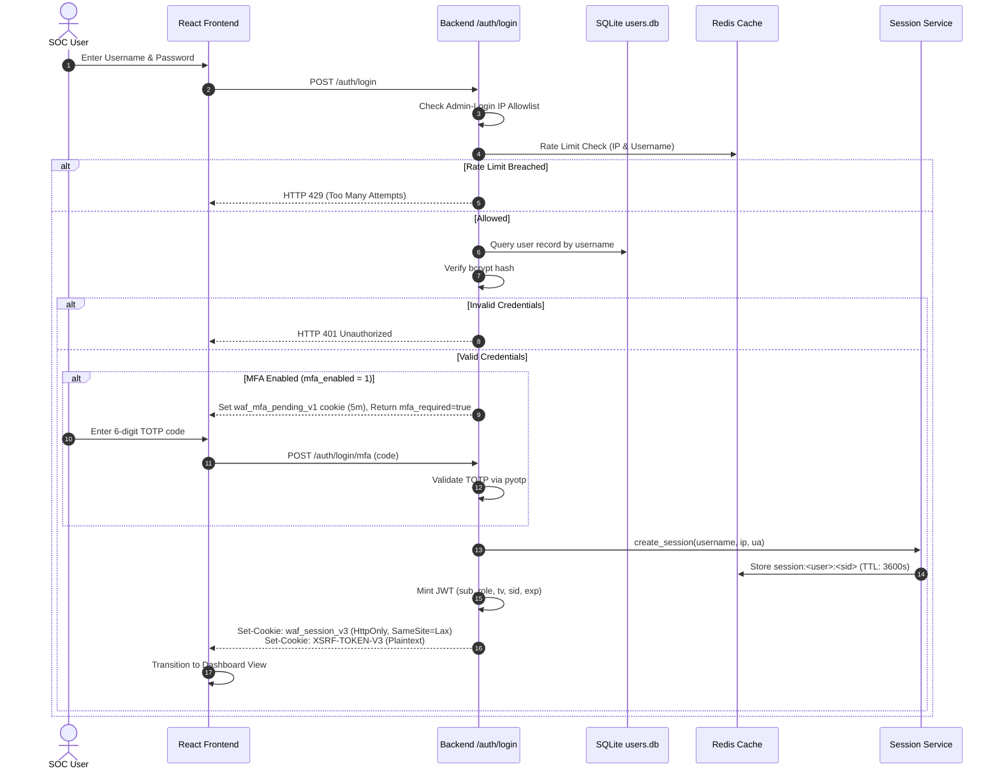
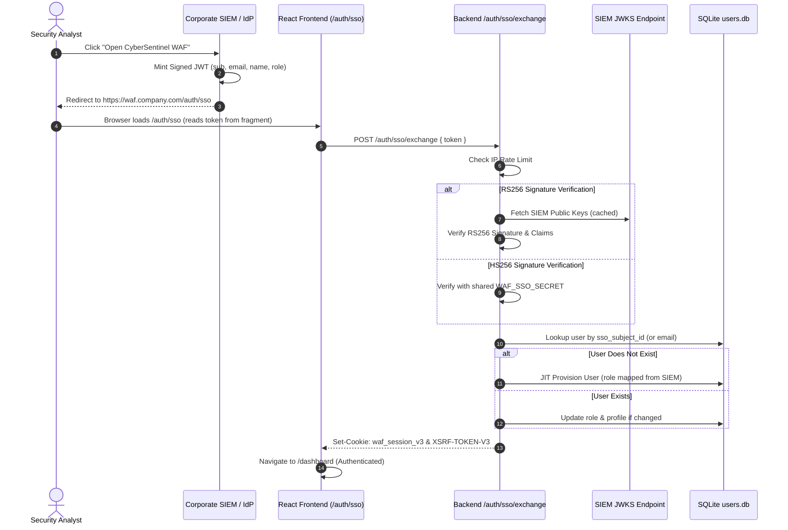
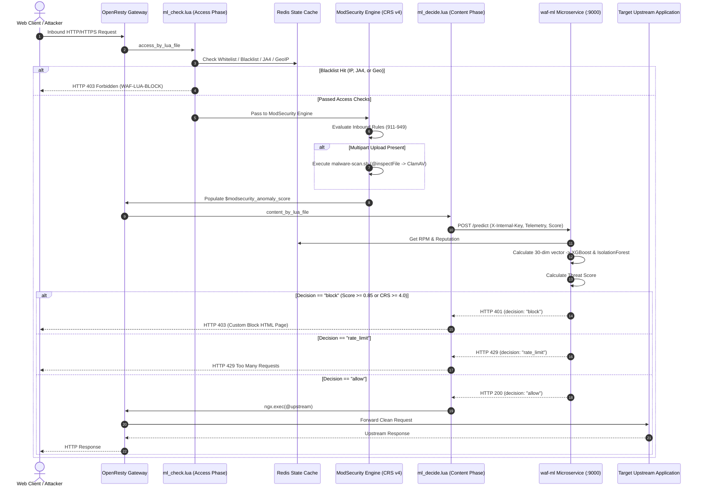
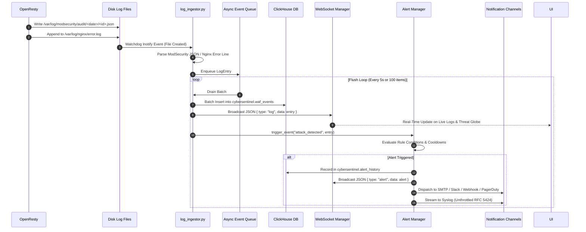
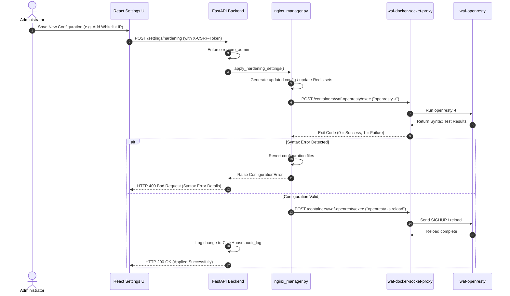
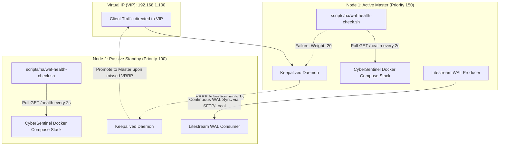

# CyberSentinel WAF — System Architecture & Component Design

> **Document Type:** Technical Architecture Specification  
> **Status:** Active Production System  
> **Repository Base:** `/opt/ModSecurity/WAF_GUI`  
> **Verification Standards:** All component interactions, phases, network topologies, and lifecycle hooks are verified directly from source code and runtime configurations.

---

## 1. High-Level Architecture Topology

CyberSentinel WAF operates as a containerized security gateway and control plane deployed via Docker Compose on an isolated bridge network (`waf-network`, IPv4 subnet `172.20.0.0/16`, IPv6 subnet `fd00::/80`).

```mermaid
graph TB
    subgraph "Public / External Network"
        Users[Web Clients / Browsers]
        Attackers[Malicious Traffic / Bots]
        SIEM[Enterprise SIEM / Identity Provider]
    end

    subgraph "Host Interface Ports"
        P3443[Port 3443: HTTPS Dashboard TLS]
        P3020[Port 3020: HTTP Dashboard Legacy]
        P443[Port 443: HTTPS WAF Gateway]
        P80[Port 80: HTTP Redirect to 443]
        P8123[Port 127.0.0.1:8123: ClickHouse Admin]
    end

    subgraph "Docker Bridge: waf-network (172.20.0.0/16)"
        subgraph "Ingress & Enforcement Gateway"
            OpenResty["waf-openresty (OpenResty 1.25.3.2)<br/>• Lua Access Phase (ml_check.lua)<br/>• ModSecurity v3 (CRS v4)<br/>• Lua Content Phase (ml_decide.lua)<br/>• Nginx Reverse Proxy"]
        end

        subgraph "Intelligence & Threat Scoring"
            MLEngine["waf-ml (FastAPI Daemon :9000)<br/>• XGBoost Classifier<br/>• Isolation Forest Detector<br/>• Drift Monitor Loop (6h)"]
            ClamAV["waf-clamav (ClamAV Daemon :3310)<br/>• INSTREAM TCP Malware Scanning"]
        end

        subgraph "Control Plane & Management"
            Backend["waf-backend (FastAPI App :8000)<br/>• REST API & Auth Engine<br/>• 12 Concurrent Background Loops<br/>• WebSocket Event Broadcaster<br/>• Nginx Config Generator"]
            Frontend["waf-frontend (Nginx Alpine :80)<br/>• React Vite SPA Static Host"]
            SocketProxy["waf-docker-socket-proxy (:2375)<br/>• Scoped Docker API Guard"]
            Certbot["waf-certbot<br/>• Automated Let's Encrypt Renewal"]
        end

        subgraph "Persistence & Caching"
            Redis[("waf-redis (:6379)<br/>• RPM & Reputation Counters<br/>• CIDR Blacklists / Whitelists<br/>• JA4 Fingerprint Store<br/>• Active Sessions Hash")]
            ClickHouse[("waf-clickhouse (:8123, :9000)<br/>• waf_events (MergeTree)<br/>• ml_events (MergeTree)<br/>• api_discovery (SummingMergeTree)<br/>• audit_log & alert_history")]
            SQLiteDB[("SQLite Databases (WAL Mode)<br/>• users.db, alerts.db, false_positives.db<br/>• api_keys.db, ml_events.db")]
            Litestream["waf-litestream<br/>• Continuous SQLite WAL Streaming"]
        end
    end

    subgraph "Upstream Application Tier"
        ProtectedApp1[Protected Application A :8080]
        ProtectedApp2[Protected Application B :3000]
        ProtectedAPI[Internal Microservices / APIs]
    end

    Users --> P3443
    Users --> P443
    Attackers --> P443
    SIEM -.-> P3443

    P3443 --> OpenResty
    P3020 --> OpenResty
    P443 --> OpenResty
    P80 --> OpenResty
    P8123 --> ClickHouse

    OpenResty -->|Check IP/JA4/Geo/DDoS| Redis
    OpenResty -->|Inference Query :9000| MLEngine
    OpenResty -->|@inspectFile Stream| ClamAV
    OpenResty -->|Proxy Clean Traffic| ProtectedApp1
    OpenResty -->|Proxy Clean Traffic| ProtectedApp2
    OpenResty -->|Proxy Clean Traffic| ProtectedAPI
    OpenResty -->|Proxy /api/ & /logs/stream| Backend
    OpenResty -->|Serve UI Assets| Frontend

    Backend -->|Analytics & Logs| ClickHouse
    Backend -->|Throttle & Cache| Redis
    Backend -->|Model Queries| MLEngine
    Backend -->|Cert Upload Malware Scan| ClamAV
    Backend -->|Scoped Exec / Restart| SocketProxy
    Backend -->|Read / Write Control State| SQLiteDB

    MLEngine -->|Reputation & Abuse Cache| Redis
    MLEngine -->|Persist Inferences| ClickHouse
    MLEngine -->|POST /alerts/trigger| Backend

    Litestream -->|Stream WAL| SQLiteDB
    Certbot -->|HTTP-01 Challenge Webroot| OpenResty
```

---

## 2. Decoupled Dual-Phase Inspection Gateway

A core innovation in CyberSentinel WAF is the separation of request evaluation into distinct OpenResty execution phases: **Access Phase** ([`ml-waf/ml_check.lua`](file:///opt/ModSecurity/WAF_GUI/ml-waf/ml_check.lua)) and **Content Phase** ([`ml-waf/ml_decide.lua`](file:///opt/ModSecurity/WAF_GUI/ml-waf/ml_decide.lua)).

### 2.1 The Phase-Order Race Condition Problem
In standard OpenResty deployments, dynamic modules (such as `ngx_http_modsecurity_module.so` loaded via `load_module`) register their handlers inside the Nginx `ACCESS` phase. However, Nginx provides no execution order guarantees between dynamic modules and static Lua directives (`access_by_lua_file`) within the same phase. 

In earlier revisions, attempting to read ModSecurity's anomaly score from `access_by_lua_file` resulted in a silent race: Lua frequently ran *before* ModSecurity evaluated the request body, reading an unpopulated anomaly score of `0.0` even on severe attacks.

### 2.2 The Dual-Phase Solution

```text
[ Client Request ]
       │
       ▼
┌───────────────────────────────────────────────────────────┐
│ 1. OPENRESTY ACCESS PHASE (ml_check.lua)                  │
│    • Control vs Data Plane Exemption Check               │
│    • mTLS Client Certificate Validation                  │
│    • Exact IP & CIDR Whitelist / Blacklist (Redis)        │
│    • External Threat Feed CIDR Enforcement (Spamhaus)     │
│    • Self-Learned Auto-Reputation Blacklist               │
│    • JA4 TLS Client Fingerprint Matching                  │
│    • GeoIP2 Country Whitelist / Blacklist                 │
│    • Verified Good-Bot Verification (Googlebot/Bingbot)   │
│    • Adaptive Per-Identity Throttle (IP/JA4/ASN)          │
│    • Bad-Bot Rate Limiting (HTTP 444 or 429)              │
│    • Positive Security API Schema Validation              │
│    • API Enumeration Detection                            │
│    • Interactive JavaScript Challenge Interstitial        │
└───────────────────────────────────────────────────────────┘
       │ (Passes stateless gates)
       ▼
┌───────────────────────────────────────────────────────────┐
│ 2. MODSECURITY v3 ENGINE INSPECTION                       │
│    • Pre-CRS Exclusions (rules-exclusions-before-crs.conf)│
│    • OWASP CRS v4 Execution (SQLi, XSS, RCE, LFI, etc.)   │
│    • Malware Scan via @inspectFile (malware-scan.sh)      │
│    • Anomaly Score Accumulation in TX collection          │
│    • Connector Variable Export: $modsecurity_anomaly_score│
└───────────────────────────────────────────────────────────┘
       │ (Access phase fully completed)
       ▼
┌───────────────────────────────────────────────────────────┐
│ 3. OPENRESTY CONTENT PHASE (ml_decide.lua)                │
│    • SecRuleEngine Posture Check (On / DetectionOnly / Off│
│    • Read $modsecurity_anomaly_score (Guaranteed Valid)   │
│    • Extract JA4 & GeoIP2 ASN                             │
│    • Synchronous HTTP POST to waf-ml:9000/predict         │
│    • Fallback to crs_only_fallback() if Daemon Offline    │
│    • Decision Enforcement (Block 403 / RateLimit 429)     │
│    • Internal Handoff: ngx.exec(@upstream) on Allow       │
└───────────────────────────────────────────────────────────┘
       │
       ▼
[ Protected Upstream Application ]
```

---

## 3. Core Component Subsystems

### 3.1 OpenResty Gateway & Custom Connector Patches
OpenResty 1.25.3.2 is compiled from source in [`openresty/Dockerfile`](file:///opt/ModSecurity/WAF_GUI/openresty/Dockerfile) with custom patches applied to upstream ModSecurity:
1. **TX Variable Accessor Patch** ([`01-libmodsecurity-tx-variable-accessor.patch`](file:///opt/ModSecurity/WAF_GUI/openresty/patches/01-libmodsecurity-tx-variable-accessor.patch)):
   Adds `msc_get_tx_variable(Transaction *transaction, const char *variable_name)` to `libmodsecurity`. This exposes internal transactional variables (such as `TX:BLOCKING_INBOUND_ANOMALY_SCORE`) via the C API.
2. **Connector Variable Patch** ([`02-connector-anomaly-score-variable.patch`](file:///opt/ModSecurity/WAF_GUI/openresty/patches/02-connector-anomaly-score-variable.patch)):
   Integrates with ModSecurity-nginx connector to register `$modsecurity_anomaly_score` as a first-class Nginx variable, accessible directly in Lua scripts.

### 3.2 Machine Learning Threat Engine (`waf-ml`)
Running as a dedicated FastAPI daemon on port `9000`:
- **Supervised Model:** XGBoost classifier (`xgboost.pkl`) trained on 30 extracted numerical features, outputting `xgb_prob` (probability of known attack patterns).
- **Unsupervised Model:** Isolation Forest (`isolation_forest.pkl`) computing `iso_score` (novelty/anomaly score indicating zero-day or unusual structural payloads).
- **Behavioral Context:** Integrates with Redis to track request velocity (`redis_rpm`), historical client bad behavior (`redis_rep`), and queries external AbuseIPDB intelligence on cache misses.
- **Decision Engine:** Blends inputs into a normalized score ($0.0 - 1.0$) and applies decision thresholds (`block`, `rate_limit`, `log`, `allow`).

### 3.3 Control Plane Backend (`waf-backend`)
Implemented in FastAPI on port `8000`:
- **API Management:** Exposes RESTful endpoints for dashboard configuration, rule management, and log review.
- **Nginx Configuration Engine:** [`nginx_manager.py`](file:///opt/ModSecurity/WAF_GUI/backend/app/services/nginx_manager.py) translates database state into validated Nginx virtual host configs, positive security directives, DDoS rate limit zones, and custom block HTML pages.
- **Docker Socket Isolation:** Interacts with the Docker daemon exclusively through `waf-docker-socket-proxy:2375`. Restricts permissions to container inspection, `openresty -t` execution, and container restarts (`EXEC`, `RESTART`, `CONTAINERS`).
- **Heartbeat & Watchdog Registry:** Monitors 12 background loops, tracking monotonic heartbeats and dispatching critical alerts if workers go silent.

### 3.4 Data Storage Architecture
- **ClickHouse Columnar Store:** Ingests high-volume access and audit logs. Optimized for time-range filtering, top-N aggregations, and geo-analytics. Employs `MergeTree` and `SummingMergeTree` engines with monthly partitions and automated TTL policies (90 days for events, 365 days for audit trails).
- **SQLite3 Relational Store:** Houses low-volume, high-criticality control-plane tables across 5 distinct database files operating in WAL mode.
- **Litestream WAL Streaming:** Replicates SQLite changes continuously, writing point-in-time state to `/backups/` to enable rapid recovery or standby node synchronization.

---

## 4. End-to-End System Flows

### 4.1 User Authentication Flow


### 4.2 SIEM SSO Mint-and-Redirect Token Exchange Flow


### 4.3 Inbound HTTP Request & L7 Attack Detection Flow


### 4.4 Asynchronous Log Ingestion & Real-Time Alerting Flow


### 4.5 Configuration Update & Safe Nginx Reload Flow


---

## 5. Active-Passive High Availability Architecture (Phase B Design)

The repository provides an active-passive failover design documented in [`configs/keepalived/keepalived.conf.example`](file:///opt/ModSecurity/WAF_GUI/configs/keepalived/keepalived.conf.example) and [`scripts/ha/README.md`](file:///opt/ModSecurity/WAF_GUI/scripts/ha/README.md):



### High Availability Invariants:
1. **Health Verification:** The keepalived probe script [`scripts/ha/waf-health-check.sh`](file:///opt/ModSecurity/WAF_GUI/scripts/ha/waf-health-check.sh) validates `GET /health` (requiring ClickHouse, Redis, and Gateway to report healthy) rather than a simple TCP socket check.
2. **State Synchronization:** Litestream continuously replicates SQLite WAL changes between nodes, guaranteeing that user accounts, active sessions, API keys, and false-positive exceptions match identically upon failover.
