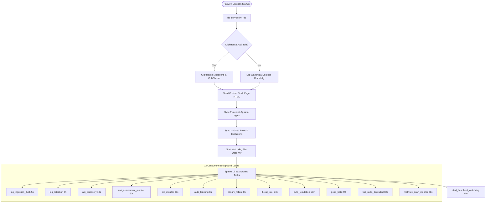
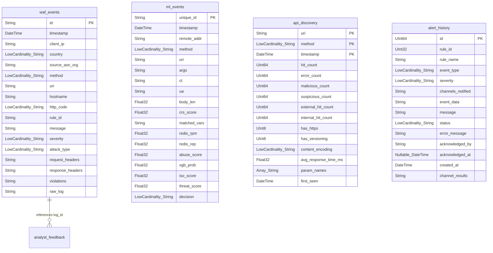
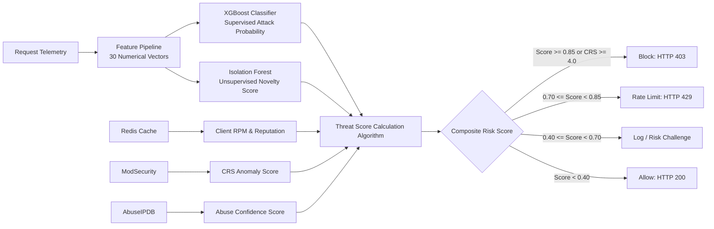
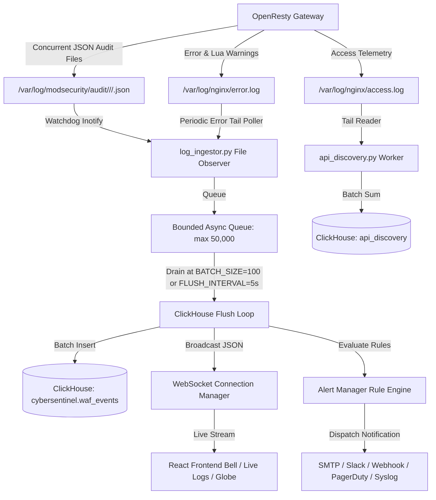
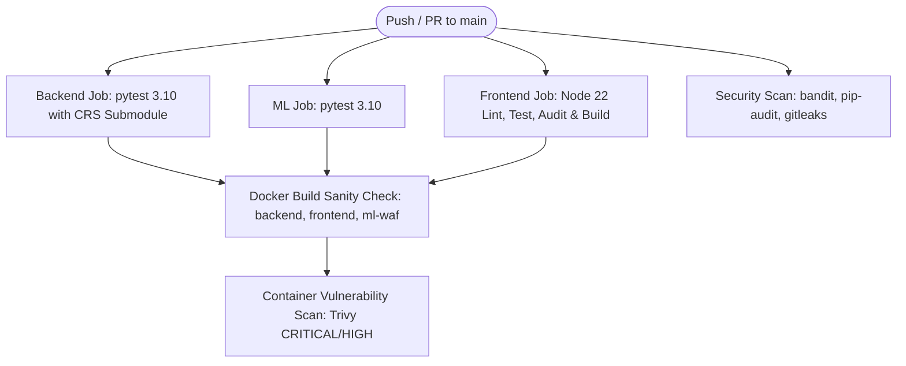
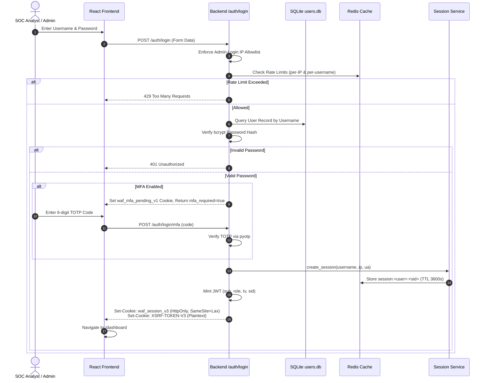
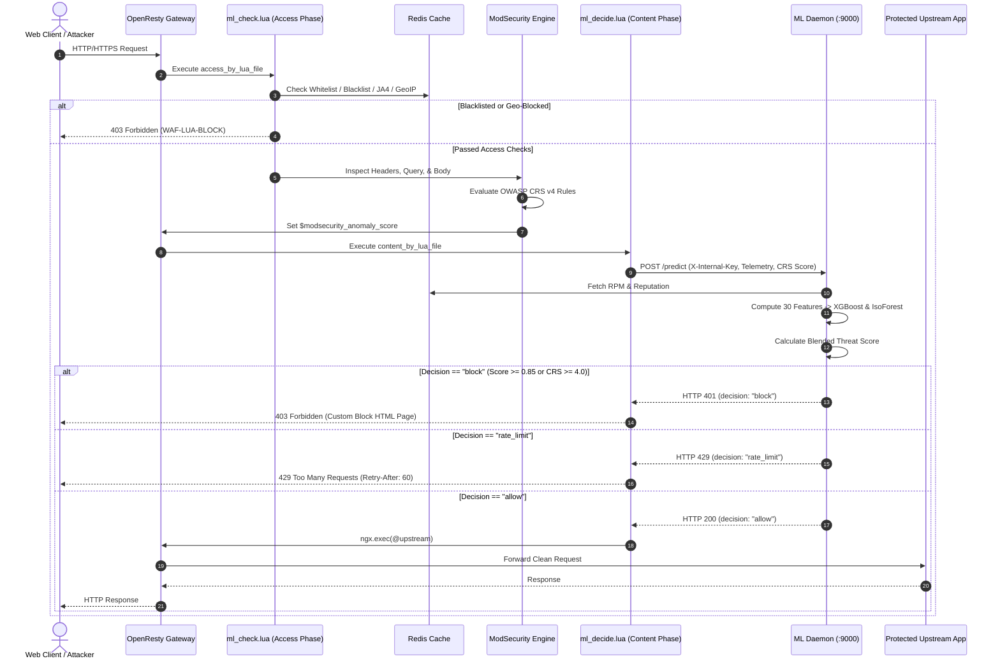
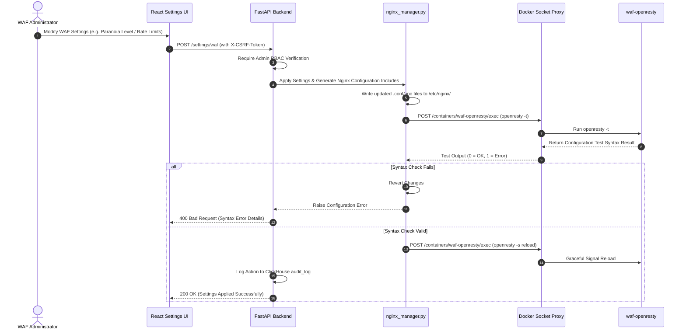

# CyberSentinel WAF — Comprehensive Technical Project Documentation

> **Status:** Active Production System  
> **Source of Truth:** Repository Codebase (`/opt/ModSecurity/WAF_GUI`)  
> **Target Audience:** Senior Software Engineers, Systems Administrators, Security Engineers (SOC), and Technical Reviewers  
> **Verification Standards:** Every architecture component, configuration key, data schema, route, and security control documented herein is verified directly from source code and runtime configurations. Features not yet implemented or existing only as templates are explicitly demarcated as `RECOMMENDED / NOT IMPLEMENTED` or `PLANNED`.

---

## Table of Contents

1. [Project Overview](#1-project-overview)
2. [System Architecture](#2-system-architecture)
3. [Technology Stack](#3-technology-stack)
4. [Repository Structure](#4-repository-structure)
5. [Frontend Architecture & Subsystem](#5-frontend-architecture--subsystem)
6. [Backend Architecture & Subsystem](#6-backend-architecture--subsystem)
7. [Database & Data Storage Subsystems](#7-database--data-storage-subsystems)
8. [Security Architecture & Controls](#8-security-architecture--controls)
9. [Core Security & WAF Engine](#9-core-security--waf-engine)
10. [Machine Learning & Behavioral AI Subsystem](#10-machine-learning--behavioral-ai-subsystem)
11. [Logging, Telemetry & Monitoring Subsystem](#11-logging-telemetry--monitoring-subsystem)
12. [API Architecture & Documentation](#12-api-architecture--documentation)
13. [Configuration & Environment Management](#13-configuration--environment-management)
14. [Deployment, Infrastructure & Container Orchestration](#14-deployment-infrastructure--container-orchestration)
15. [Testing Framework & Verification Suite](#15-testing-framework--verification-suite)
16. [Continuous Integration & Delivery (CI/CD)](#16-continuous-integration--delivery-cicd)
17. [Operations & Troubleshooting Runbook](#17-operations--troubleshooting-runbook)
18. [Security & Operational Best Practices](#18-security--operational-best-practices)
19. [Known Limitations & Technical Debt](#19-known-limitations--technical-debt)
20. [Complete Feature Inventory](#20-complete-feature-inventory)
21. [Complete System Flows](#21-complete-system-flows)
22. [Technical Glossary](#22-technical-glossary)

---

## 1. Project Overview

### 1.1 Purpose
**CyberSentinel WAF** is a self-contained, enterprise-grade Web Application Firewall (WAF) and Security Operations Center (SOC) management platform. It acts as an intelligent reverse proxy gateway positioned in front of upstream web applications and APIs, inspecting inbound HTTP/HTTPS traffic to prevent exploit attempts, volumetric denial-of-service (DoS/DDoS) floods, credential stuffing, automated scrapers, and zero-day vulnerabilities.

### 1.2 Problems Solved
Traditional network perimeter firewalls operate at Layers 3 and 4, remaining blind to application-layer (Layer 7) exploit payloads carried within HTTP headers, query strings, cookies, JSON bodies, and multipart file uploads. Conversely, standalone signature-based WAFs (such as unaugmented ModSecurity) suffer from high maintenance overhead, rigid rule matching leading to false-positive operational lockouts, lack of behavioral visibility, and vulnerability to polymorphic or novel attack vectors.

CyberSentinel solves these challenges by combining:
1. **Deterministic Rule Inspection:** OWASP ModSecurity Core Rule Set (CRS v4) executing natively in OpenResty for deep signature matching.
2. **Behavioral Machine Learning:** A two-stage AI engine combining supervised classification (XGBoost) and unsupervised novelty detection (Isolation Forest) with sliding-window reputation scoring.
3. **Decoupled Architecture:** Dual-phase request evaluation separating stateless access-phase gates (IP/JA4/Geo/mTLS/DDoS) from stateful content-phase scoring (ModSecurity anomaly scores + ML inference), eliminating phase-order race conditions.
4. **Autonomous Operational Feedback:** Automated false-positive tracking, rule canary rollouts, auto-learning exclusion suggestion, and zero-downtime Nginx hot reloads.
5. **Unified Security Management:** Single-pane-of-glass React dashboard providing real-time log ingestion, attack geo-visualization, rule management, automated API discovery, and multi-channel alerting.

### 1.3 Major Capabilities
- **Dual-Engine Layer 7 Inspection:** Real-time OWASP Top 10 mitigation (SQLi, XSS, RCE, LFI/RFI, SSRF, Deserialization) via ModSecurity v3.0.14+ and CRS v4.
- **Adaptive Threat Scoring:** Blended risk score (0.0 to 1.0) combining normalized CRS anomaly scores, XGBoost probability, Isolation Forest novelty score, AbuseIPDB reputation, and Redis historical telemetry.
- **Multi-Vector DDoS & Bot Mitigation:** Token-bucket rate limiting per IP/session/API-key, sliding-window bad-bot rate limits with Silent Drop (HTTP 444) or HTTP 429 responses, JA4 TLS fingerprint blacklisting, GeoIP2 country filtering, and an interactive JS Challenge interstitial.
- **API Security & Continuous Discovery:** Passive discovery of API endpoints from live traffic, automated parameter inventory (names only, values never stored), security posture grading (A to F), OpenAPI spec drift reconciliation, and JSON schema enforcement.
- **Virtual Patching & Rule Canary Deployment:** Instant deployment of custom ModSecurity rules for zero-day CVE mitigation, with bounded-window canary rollouts that track sole-match rates to auto-promote or auto-rollback rules.
- **Web Anti-Defacement (File Integrity Monitoring):** Real-time SHA-256 hash monitoring of critical web assets with automatic memory-cached rollback and alert generation upon tampering.
- **Enterprise Identity & Multi-Tenancy:** Role-Based Access Control (`Admin`, `Analyst`, `App Admin`), TOTP Multi-Factor Authentication (MFA), SIEM SSO (mint-and-redirect JWT exchange with JIT provisioning), and HttpOnly cookie sessions with per-session Redis revocation.
- **High-Throughput Analytics & Logging:** Event ingestion into ClickHouse with monthly partitioning and automated 90/365-day TTLs, paired with a real-time WebSocket event broadcaster and multi-channel notification engine (SMTP, Slack, Generic Webhook, PagerDuty, Syslog/SIEM).

### 1.4 Target Users and Use Cases
- **Security Operations Center (SOC) Analysts:** Monitoring live attack streams, analyzing threat globe origins, triaging false positives, and acknowledging security alerts.
- **WAF & Infrastructure Administrators:** Managing virtual hosts for protected upstream applications, configuring DDoS thresholds, updating OWASP CRS rule sets, and adjusting WAF postures.
- **Application Administrators (`App Admin`):** Maintaining rate limits, custom SSL certificates, API schemas, and access headers for specific assigned applications without full system access.
- **Compliance & Audit Teams:** Extracting compliance event reports (CSV, CEF, LEEF), reviewing immutable system audit logs, and verifying cryptographic data protections.

---

## 2. System Architecture

### 2.1 Complete Architectural Overview
CyberSentinel WAF is architected as a set of decoupled, containerized services managed via Docker Compose on an isolated bridge network (`waf-network`, `172.20.0.0/16` and `fd00::/80`).

```mermaid
graph TB
    subgraph "External Traffic"
        Client[🌐 External Client / Browser / Attacker]
        SIEM_SSO[🏢 Enterprise SIEM / Identity Provider]
    end

    subgraph "Edge Gateway (waf-openresty :80, :443, :3020, :3443)"
        OpenResty[OpenResty Reverse Proxy & Lua Engine]
        ModSec[ModSecurity v3 Engine + OWASP CRS v4]
        LuaAccess[Access Phase: ml_check.lua]
        LuaContent[Content Phase: ml_decide.lua]
        NginxCache[Nginx Fastcgi/Proxy Cache]
    end

    subgraph "Core Processing & Security Engine"
        MLEngine["ML Daemon: waf-ml (:9000)<br/>FastAPI + XGBoost + IsolationForest"]
        Backend["Control Plane: waf-backend (:8000)<br/>FastAPI Application"]
        Frontend["UI Host: waf-frontend (:80)<br/>Nginx + React SPA"]
        ClamAV["Malware Scanner: waf-clamav (:3310)<br/>clamd daemon TCP INSTREAM"]
    end

    subgraph "Data Storage & State Management"
        Redis[("In-Memory State: waf-redis (:6379)<br/>RPM, Reputation, Blacklists, JA4, Cache")]
        ClickHouse[("Analytics Store: waf-clickhouse (:8123, :9000)<br/>MergeTree / SummingMergeTree Tables")]
        SQLite_Config[("SQLite Control DBs<br/>users.db, alerts.db, false_positives.db,<br/>api_keys.db, ml_events.db")]
        Litestream["Replication: waf-litestream<br/>Continuous WAL Streaming"]
    end

    subgraph "Management & Sidecars"
        SocketProxy["Docker Socket Proxy: waf-docker-socket-proxy (:2375)<br/>Scoped API Access (CONTAINERS, EXEC, RESTART)"]
        Certbot["SSL Automation: waf-certbot<br/>Let's Encrypt HTTP-01 Renewal Loop"]
    end

    Client -->|HTTP:80 / HTTPS:443| OpenResty
    Client -->|HTTPS:3443 / HTTP:3020| OpenResty
    SIEM_SSO -.->|JWT Exchange| Backend

    OpenResty --> LuaAccess
    LuaAccess -->|Check Whitelist/Blacklist/JA4/Geo/DDoS| Redis
    LuaAccess --> ModSec
    ModSec --> LuaContent
    LuaContent -->|Sync POST /predict with X-Internal-Key| MLEngine
    LuaContent -->|Allow| Upstream[🎯 Protected Upstream Services]

    Backend -->|Scoped Docker Exec/Restart| SocketProxy
    Backend -->|Read/Write Control Tables| SQLite_Config
    Backend -->|Analytics Queries| ClickHouse
    Backend -->|Rate Limiting & Threat Feeds| Redis
    Backend -->|Cert File Malware Scan| ClamAV
    OpenResty -.->|@inspectFile Upload Scan| ClamAV

    MLEngine -->|Cache Miss AbuseIPDB Query| Redis
    MLEngine -->|Persist ml_events| ClickHouse
    MLEngine -->|Fallback Persist| SQLite_Config
    MLEngine -->|Internal Alert Trigger POST /alerts/trigger| Backend

    Backend -->|Live Log Ingest Watcher| OpenResty
    Backend -->|Ingest modsec_audit.log| ClickHouse
    Backend -->|WebSocket Broadcast| Frontend
    OpenResty -->|Reverse Proxy /api/| Backend
    OpenResty -->|Serve UI| Frontend

    Litestream -->|Stream WAL| BackupsDir[📁 Backup Storage]
    Certbot -->|HTTP-01 Challenge| OpenResty
```

### 2.2 Components and Services

| Container Name | Service Identifier | Base Image / Build Context | Core Responsibilities |
|---|---|---|---|
| `waf-openresty` | `openresty` | Custom [`openresty/Dockerfile`](file:///opt/ModSecurity/WAF_GUI/openresty/Dockerfile) (OpenResty 1.25.3.2 + ModSecurity v3 + GeoIP2) | L7 Gateway, TLS termination, ModSecurity CRS inspection, Lua access/content phases, caching, and upstream proxying. |
| `waf-backend` | `backend` | Custom [`backend/Dockerfile`](file:///opt/ModSecurity/WAF_GUI/backend/Dockerfile) (Python 3.12-slim) | REST API, background workers (log ingestion, defacement, retention, canary, threat feeds), WebSocket server, configuration management. |
| `waf-frontend` | `frontend` | Multi-stage [`frontend/Dockerfile`](file:///opt/ModSecurity/WAF_GUI/frontend/Dockerfile) (Node 22-alpine -> Nginx alpine) | Production host serving compiled Vite + React single-page application static assets. |
| `waf-ml` | `ml-engine` | Custom [`ml-waf/Dockerfile`](file:///opt/ModSecurity/WAF_GUI/ml-waf/Dockerfile) (Python 3.12-slim) | High-speed inference daemon (`/predict`), XGBoost classifier, Isolation Forest anomaly detector, drift monitor, model retraining. |
| `waf-clickhouse` | `clickhouse` | `clickhouse/clickhouse-server:24.6-alpine` | High-throughput analytical log engine storing `waf_events`, `ml_events`, `api_discovery`, `audit_log`, and `alert_history`. |
| `waf-redis` | `redis` | `redis:7-alpine` | Sub-millisecond in-memory cache for IP RPM, client reputation scores, JA4 sets, CIDR blacklists, session tracking, and schema validation. |
| `waf-clamav` | `clamav` | `clamav/clamav:stable` | ClamAV antivirus daemon exposing TCP port 3310 (INSTREAM) for uploaded file scanning via `@inspectFile` and dashboard cert uploads. |
| `waf-docker-socket-proxy` | `docker-socket-proxy` | `tecnativa/docker-socket-proxy:0.3.0` | Security firewall sitting in front of `/var/run/docker.sock`, restricting backend privileges to `CONTAINERS=1`, `EXEC=1`, and `RESTART=1`. |
| `waf-certbot` | `certbot` | `certbot/certbot:latest` | Automated Let's Encrypt renewal loop (polling every 12 hours via webroot HTTP-01 challenge). |
| `waf-litestream` | `litestream` | `litestream/litestream:0.5.17` | Continuous streaming replication of SQLite databases (`users.db`, `alerts.db`, `api_keys.db`, `ml_events.db`, `false_positives.db`). |

### 2.3 Detailed Request/Response Execution Flow

The gateway operates under a strict two-phase inspection architecture that eliminates race conditions between OpenResty dynamic module initialization and Lua phase execution:

#### Phase 1: OpenResty Access Phase (`ml_check.lua`)
Every request hitting OpenResty executes [`ml-waf/ml_check.lua`](file:///opt/ModSecurity/WAF_GUI/ml-waf/ml_check.lua) during `access_by_lua_file`:
1. **Control-Plane vs. Data-Plane Discrimination:** Checks whether request targets the dashboard control plane (`$waf_control_plane == "1"`) or a protected app. On the control plane, read-only telemetry and auth endpoints skip heuristic checks to avoid telemetry recursion loops.
2. **mTLS Verification:** If the targeted app enforces mTLS (`$waf_mtls_mode == "enforce"`), verifies `$ssl_client_verify == "SUCCESS"`. If invalid, immediately rejects with HTTP 403 (`WAF-LUA-BLOCK reason=mtls`).
3. **Exact & CIDR IP Authorization:** Connects to Redis via [`waf_redis.lua`](file:///opt/ModSecurity/WAF_GUI/ml-waf/waf_redis.lua). Checks exact matches and CIDRs in `waf:whitelist`, `waf:whitelist:cidrs`, `waf:blacklist`, `waf:blacklist:cidrs`, `waf:blacklist:feed:cidrs` (Spamhaus DROP/EDROP, Emerging Threats), and `waf:blacklist:auto:<ip>` (self-learned reputation). If whitelisted, skips remaining Lua checks; if blacklisted, returns HTTP 403 (`WAF-LUA-BLOCK reason=ip_blacklist`).
4. **JA4 Fingerprint Enforcement:** Reads TLS client fingerprint cached during SSL handshake by [`ja4.lua`](file:///opt/ModSecurity/WAF_GUI/ml-waf/ja4.lua). Checks `waf:blacklist:ja4`. If matched, returns HTTP 403 (`WAF-LUA-BLOCK reason=ja4`).
5. **GeoIP2 Country Verification:** Reads `$geoip2_data_country_code`. Evaluates `waf:geo:block_mode` (`deny` or `allow`) against `waf:geo:countries`. Returns HTTP 403 if blocked (`WAF-LUA-BLOCK reason=geo_block`).
6. **Good-Bot Exemption:** Verifies if User-Agent matches official crawlers (Googlebot, Bingbot) and confirms source IP falls within officially published CIDRs stored in `waf:goodbot:cidrs:<source>`. If verified, exempts request from adaptive throttling.
7. **Adaptive Per-Identity Throttle:** Computes composite reputation from Redis (`rep:<ip>`, `rep:ja4:<fingerprint>`, `rep:asn:<asn>`). If reputation exceeds thresholds (3.0 for IP/JA4, 15.0 for ASN), applies a strict rolling throttle (max 10 requests per 60s). Excess requests receive HTTP 429 (`WAF-LUA-BLOCK reason=adaptive_throttle`).
8. **Bad-Bot Rate Limiting & JS Challenge:** If User-Agent indicates a malicious bot/scraper (`is_bad_bot == "1"`):
   - In Rate Limit mode: throttles to 1 request per 60s; subsequent requests receive HTTP 429 or Silent Drop HTTP 444 (`WAF-LUA-BLOCK reason=bot_ua_limit`).
   - In JS Challenge mode: serves an interactive JavaScript challenge interstitial via [`bot_challenge.lua`](file:///opt/ModSecurity/WAF_GUI/ml-waf/bot_challenge.lua).
9. **Positive Security Schema Validation:** Validates request parameters and structure against OpenAPI schemas loaded in Redis via [`schema_validate.lua`](file:///opt/ModSecurity/WAF_GUI/ml-waf/schema_validate.lua).
10. **API Enumeration Detection:** Tracks sequential resource scanning via [`enum_detect.lua`](file:///opt/ModSecurity/WAF_GUI/ml-waf/enum_detect.lua).

#### Phase 2: ModSecurity Engine Inspection
The request passes into the ModSecurity v3 engine configured via [`configs/nginx/modsec/main.conf`](file:///opt/ModSecurity/WAF_GUI/configs/nginx/modsec/main.conf):
1. **Rule Pre-exclusions:** Executes [`rules-exclusions-before-crs.conf`](file:///opt/ModSecurity/WAF_GUI/configs/nginx/modsec/rules-exclusions-before-crs.conf).
2. **OWASP CRS v4 Execution:** Executes core rule sets (`REQUEST-911` through `REQUEST-949`).
3. **Anomaly Accumulation:** ModSecurity calculates `TX:BLOCKING_INBOUND_ANOMALY_SCORE`. Native blocking rule 949110 is removed (`SecRuleRemoveById 949110`) in favor of unified evaluation in Content Phase, except when native ModSecurity threshold is explicitly reached.
4. **Patched Variable Export:** Custom connector patch (`02-connector-anomaly-score-variable.patch`) extracts the internal anomaly score and assigns it to Nginx variable `$modsecurity_anomaly_score`.

#### Phase 3: OpenResty Content Phase (`ml_decide.lua`)
For locations configured with `$waf_upstream_location`, execution transitions to [`ml-waf/ml_decide.lua`](file:///opt/ModSecurity/WAF_GUI/ml-waf/ml_decide.lua):
1. **SecRuleEngine Posture Check:** Checks `$waf_sec_rule_engine_posture`. If set to `DetectionOnly` or `Off`, passes request immediately to upstream via `ngx.exec(upstream_location)`.
2. **Payload Compilation:** Bundles request metadata, headers, body length, `$modsecurity_anomaly_score`, JA4 fingerprint, and ASN into a JSON payload.
3. **Inference Query:** Dispatches synchronous HTTP POST to `http://waf-ml:9000/predict` with header `X-Internal-Key`.
   - **Fallback Mode:** If `waf-ml` is unreachable, triggers `crs_only_fallback()`. If `crs_score >= 4.0`, blocks with HTTP 403; otherwise allows.
4. **Decision Enforcement:**
   - **HTTP 401 (Block):** Returns custom WAF block page (`WAF-LUA-BLOCK reason=ml_engine code=403`).
   - **HTTP 429 (Rate Limit):** Returns HTTP 429 with `Retry-After: 60`.
   - **HTTP 200 (Allow):** If response carries `X-WAF-Risk-Challenge: 1` and risk challenge is enabled, executes risk challenge interstitial; otherwise forwards request to upstream via internal rewrite `ngx.exec(upstream_location)`.

---

## 3. Technology Stack

### 3.1 Technology Matrix

| Layer | Technology | Version | Purpose / Implementation |
|---|---|---|---|
| **Web Server / Gateway** | OpenResty | `1.25.3.2` | High-performance Nginx gateway with embedded LuaJIT engine |
| **WAF Engine** | libmodsecurity (ModSecurity v3) | `v3.0.14+` (`v3/master`) | Compiled from source with custom TX variable accessor patch |
| **WAF Connector** | ModSecurity-nginx | Source (`master`) | Dynamic Nginx module with patched `$modsecurity_anomaly_score` |
| **Core Rule Set** | OWASP CRS | `v4.x` (Auto-updated) | Comprehensive Layer 7 signature detection ruleset |
| **GeoIP Module** | `ngx_http_geoip2_module` | Source (`master`) | MaxMind GeoIP2 MMDB reader (Country & ASN lookups) |
| **Control Plane Backend** | Python / FastAPI | `Python 3.12` / `FastAPI 0.115+` | Async REST API, WebSocket server, background orchestration |
| **ASGI Server** | Uvicorn | `0.30+` | High-throughput asynchronous server running backend and ML services |
| **Frontend Framework** | React / Vite | `React 18.3` / `Vite 5.4` | Modern SPA with code splitting, CSS custom properties, Lucide icons |
| **Animation & Charts** | Framer Motion / Recharts | `framer-motion 11.3` / `recharts 2.12` | Fluid transitions, attack timelines, KPI metrics, distribution charts |
| **In-Memory Cache** | Redis | `7-alpine` | High-speed cache for RPM, reputation, CIDRs, session store |
| **Analytical Database** | ClickHouse | `24.6-alpine` | Columnar store for audit logs, ML events, API discovery, alerts |
| **Configuration Store** | SQLite3 | `3.45+` (WAL mode) | Local persistence for users, alert rules, FP exclusions, API keys |
| **Machine Learning** | XGBoost / Scikit-Learn | `xgboost 2.0+` / `scikit-learn 1.4+` | Supervised threat classification & unsupervised novelty detection |
| **Data Science Stack** | NumPy / Pandas / PyTZ | Modern stable | Feature vector transformations and time-series aggregations |
| **Antivirus Scanner** | ClamAV (`clamd`) | `clamav:stable` | Malware detection daemon scanning file uploads via INSTREAM TCP |
| **Container Engine** | Docker & Compose | Docker Engine `26.1+` / Compose v2 | Multi-container lifecycle, resource limits, bridge networking |
| **Container Proxy** | Docker Socket Proxy | `0.3.0` | Least-privilege Docker socket firewall |
| **HA Replication** | Litestream | `0.5.17` | Continuous streaming SQLite WAL replication |
| **Testing Tools** | Pytest / Vitest / RTL | `pytest 8.x` / `vitest 2.0+` | Unit, integration, security, and UI regression suites |
| **Security Linters** | Bandit / pip-audit / Gitleaks | Pinned CI versions | Static analysis, CVE dependency scanning, secret leakage audits |

---

## 4. Repository Structure

### 4.1 Root Directory Layout

```text
/opt/ModSecurity/WAF_GUI/
├── backend/                       # Python FastAPI Backend Control Plane
│   ├── app/                       # Core Application Package
│   │   ├── config/                # Settings management and SQLite configuration databases
│   │   ├── data/                  # SQLite databases, GeoIP MMDB files, and backups
│   │   ├── middlewares/           # Custom middleware (CORS, security headers, request ID)
│   │   ├── models/                # Pydantic data schemas and response definitions
│   │   ├── parsers/               # ModSecurity and Nginx log parsers
│   │   ├── routes/                # FastAPI endpoint controllers (REST & WebSockets)
│   │   ├── services/              # Business logic layer (Nginx, rules, ClickHouse, auth)
│   │   ├── utils/                 # Security utilities (CSRF, encryption, rate limiting)
│   │   ├── websocket/             # Live log and notification WebSocket manager
│   │   └── main.py                # Backend entry point and lifecycle orchestration
│   ├── tests/                     # Comprehensive backend Pytest suite (50 test files)
│   ├── Dockerfile                 # Backend container definition (Python 3.12-slim + Docker CLI)
│   ├── requirements.txt           # Production Python dependencies
│   └── requirements-dev.txt       # Development and CI testing dependencies
├── configs/                       # System Configurations & Initialization Schemas
│   ├── certs/                     # Trusted certificates (e.g. SIEM edge certs)
│   ├── clickhouse/                # ClickHouse schema initialization (init.sql)
│   ├── keepalived/                # Active-Passive HA VRRP configuration template
│   ├── litestream/                # Litestream continuous SQLite replication configuration
│   └── nginx/                     # Reverse proxy, ModSecurity rules, and vhosts
│       ├── conf.d/                # Generated rate limit, caching, and posture includes
│       ├── custom_pages/          # Custom WAF block HTML page templates
│       ├── modsec/                # ModSecurity main.conf, CRS, overrides, and malware scripts
│       ├── sites-available/       # Template vhosts and generated protected app configs
│       ├── sites-enabled/         # Active vhost symlinks
│       ├── ssl/                   # SSL/TLS certificates and mTLS CA store
│       └── nginx.conf             # Primary OpenResty configuration
├── frontend/                      # React SPA Dashboard (Vite)
│   ├── public/                    # Static assets, branding, and favicons
│   ├── src/                       # React Application Source Code
│   │   ├── components/            # Reusable UI widgets, modals, wizards, and menus
│   │   ├── context/               # React context providers (Theme, Confirmation modal)
│   │   ├── hooks/                 # Custom React hooks (useToast, useConfirm, usePagination)
│   │   ├── pages/                 # Full-page dashboard views (Overview, Events, Rules, etc.)
│   │   ├── services/              # Frontend API client (api.js, cookie handling)
│   │   ├── utils/                 # Frontend formatting and date helpers
│   │   ├── App.jsx                # Application root, routing router, and global state
│   │   ├── index.css              # Design token variables and comprehensive styling
│   │   ├── main.jsx               # React DOM entry point
│   │   └── navigation.js          # Unified navigation hierarchy definition
│   ├── Dockerfile                 # Multi-stage production container (Node build -> Nginx)
│   ├── package.json               # NPM dependencies and scripts
│   └── vite.config.js             # Vite bundler configuration
├── ml-waf/                        # Machine Learning Security Engine Subsystem
│   ├── lualib/                    # Lua helper libraries (resty.http)
│   ├── models/                    # Trained model binaries (.pkl) and backup snapshots
│   │   └── backups/               # Pruned historical model weight archives
│   ├── bot_challenge.lua          # Lua JS-challenge interstitial renderer and validator
│   ├── collect_data.py            # Dataset compilation from ClickHouse audit logs
│   ├── crs_audit_enrichment.py    # Background script enriching CRS scores from audit logs
│   ├── drift_monitor.py           # Real-time telemetry monitor triggering retraining on drift
│   ├── enum_detect.lua            # Lua sequential API enumeration detection module
│   ├── feature_pipeline.py        # 30-dimensional request feature extractor
│   ├── generate_dummy_models.py   # Bootstrap placeholder generator for passive mode
│   ├── ja4.lua / ja4_core.lua     # Passive JA4 TLS client fingerprint extraction
│   ├── ml_check.lua               # OpenResty Access-Phase Lua inspection hook
│   ├── ml_decide.lua              # OpenResty Content-Phase Lua inference hook
│   ├── ml_server.py               # FastAPI ML inference microservice entry point
│   ├── redis_features.py          # Redis interface for RPM, reputation, and AbuseIPDB cache
│   ├── retrain.sh                 # End-to-end retraining automation with accuracy gates
│   ├── schema_validate.lua        # Lua positive-security OpenAPI schema validator
│   ├── threat_score.py            # Normalized risk score algorithm and decision router
│   ├── train_iso.py               # Isolation Forest unsupervised training script
│   ├── train_xgb.py               # XGBoost classifier supervised training script
│   └── Dockerfile                 # ML engine container definition
├── openresty/                     # Gateway Container Build Assets
│   ├── patches/                   # C/C++ source patches for ModSecurity & Nginx connector
│   └── Dockerfile                 # Multi-stage compilation container for OpenResty & ModSec
├── scripts/                       # System Administration, Migration & Utility Scripts
│   ├── ha/                        # Active-passive health check probe scripts
│   ├── configure-production.sh    # Interactive post-install SSL/CORS configuration
│   ├── deploy-frontend.sh         # Production frontend compile and deploy helper
│   ├── generate-secrets.sh        # Cryptographic key generator for .env files
│   ├── migrate_sqlite_to_clickhouse.py # Legacy SQLite to ClickHouse migration utility
│   ├── reset-password.py          # Emergency CLI password reset tool for users.db
│   ├── update-crs.sh              # Automated OWASP Core Rule Set updater
│   └── verify_clickhouse_db.py    # Diagnostic validation script for ClickHouse logging
├── .github/workflows/ci.yml       # Complete CI pipeline (Pytest, Vitest, Bandit, Gitleaks, Trivy)
├── docker-compose.yml             # Primary production service orchestration
├── PRODUCTION_GUIDE.md            # Production deployment instructions and procedures
├── README.md                      # Architecture and operational overview
└── setup.sh                       # Interactive turnkey deployment script
```

---

## 5. Frontend Architecture & Subsystem

### 5.1 Architecture & Single Page Navigation
The frontend is constructed using **React 18** and bundled with **Vite 5**. It operates as a Single Page Application (SPA) utilizing HTML5 History API routing without external router dependencies, ensuring zero-latency transitions and strict state preservation.

Routes are centrally registered in [`frontend/src/App.jsx`](file:///opt/ModSecurity/WAF_GUI/frontend/src/App.jsx) via `TAB_ROUTES` and mapped to browser paths:

| Route Path | Internal Tab ID | Rendered Page Component | Access Scope |
|---|---|---|---|
| `/dashboard` | `overview` | [`Overview.jsx`](file:///opt/ModSecurity/WAF_GUI/frontend/src/pages/Overview.jsx) | All Roles |
| `/events` | `events` | [`Events.jsx`](file:///opt/ModSecurity/WAF_GUI/frontend/src/pages/Events.jsx) | All Roles |
| `/threat-globe` | `threat_globe` | [`ThreatGlobe.jsx`](file:///opt/ModSecurity/WAF_GUI/frontend/src/pages/ThreatGlobe.jsx) | All Roles |
| `/protection` | `protection` | [`ProtectionSection.jsx`](file:///opt/ModSecurity/WAF_GUI/frontend/src/pages/ProtectionSection.jsx) | All Roles (`App Admin` scoped) |
| `/false-positives` | `false_positives` | [`FalsePositivesExceptions.jsx`](file:///opt/ModSecurity/WAF_GUI/frontend/src/pages/FalsePositivesExceptions.jsx) | All Roles |
| `/ml-engine` | `ml_engine` | [`MLEngine.jsx`](file:///opt/ModSecurity/WAF_GUI/frontend/src/pages/MLEngine.jsx) | All Roles |
| `/rules` | `rules` | [`Rules.jsx`](file:///opt/ModSecurity/WAF_GUI/frontend/src/pages/Rules.jsx) | All Roles |
| `/api-protection` | `api_protection` | [`ApiProtection.jsx`](file:///opt/ModSecurity/WAF_GUI/frontend/src/pages/ApiProtection.jsx) | All Roles |
| `/reports` | `reports` | [`SecurityReports.jsx`](file:///opt/ModSecurity/WAF_GUI/frontend/src/components/SecurityReports.jsx) | All Roles |
| `/integrations` | `integrations` | [`AlertsIntegrations.jsx`](file:///opt/ModSecurity/WAF_GUI/frontend/src/pages/AlertsIntegrations.jsx) | All Roles |
| `/virtual-patching`| `virtual_patching`| [`VirtualPatching.jsx`](file:///opt/ModSecurity/WAF_GUI/frontend/src/pages/VirtualPatching.jsx) | Admin Only |
| `/users` | `users` | [`UserManagement.jsx`](file:///opt/ModSecurity/WAF_GUI/frontend/src/components/UserManagement.jsx) | Admin Only |
| `/settings` | `settings` | [`Settings.jsx`](file:///opt/ModSecurity/WAF_GUI/frontend/src/pages/Settings.jsx) | Admin Only |
| `/auth/sso` | N/A | [`SsoCallback.jsx`](file:///opt/ModSecurity/WAF_GUI/frontend/src/components/SsoCallback.jsx) | Public (Auth Exchange) |

### 5.2 UI System & Design Tokens
Styling is managed via a centralized design system in [`frontend/src/index.css`](file:///opt/ModSecurity/WAF_GUI/frontend/src/index.css). It uses CSS custom properties supporting dynamic theme switching (`dark` and `light` modes):
- **Core Tokens:** `--bg-primary`, `--bg-secondary`, `--bg-card`, `--text-primary`, `--text-secondary`, `--border-color`.
- **Accent & Severity Hierarchy:**
  - Critical / Block: `#ef4444` (`--danger-color`)
  - High / Rate Limit: `#f97316` (`--warning-color`)
  - Medium / Caution: `#eab308` (`--alert-color`)
  - Low / Clean: `#10b981` (`--success-color`)
  - Primary Brand / Cyber: `#3b82f6` / `#06b6d4` (`--accent-color`)

### 5.3 State Management & Data Fetching
- **Client-Side Storage:** Avoids storing sensitive credentials or access tokens in `localStorage` or `sessionStorage` (preventing token theft via XSS).
- **Session State:** Authenticated user profile, active role, and system permissions are bootstrapped on page load via `GET /auth/me` and held in React component state.
- **API Client:** [`frontend/src/services/api.js`](file:///opt/ModSecurity/WAF_GUI/frontend/src/services/api.js) encapsulates all Axios/Fetch calls. Automatically extracts `XSRF-TOKEN-V3` from document cookies and attaches it as `X-CSRF-Token` on state-changing requests (`POST`, `PUT`, `DELETE`, `PATCH`). Handles automatic 401 redirection to login.

### 5.4 Visualization & Dashboard Interactivity
- **Charts:** Built using **Recharts**. Includes Attack Timeline Area Charts, Severity Donut Charts, Top Targeted Endpoints Horizontal Bar Charts, and Model Training Accuracy Gauges.
- **Threat Globe:** [`ThreatGlobe.jsx`](file:///opt/ModSecurity/WAF_GUI/frontend/src/pages/ThreatGlobe.jsx) renders a 3D Canvas / Three.js-style spherical globe showing inbound attack trajectories originating from attacker GeoIP coordinates and terminating at the WAF server's geo-location (auto-detected or manually configured).
- **Command Palette:** Quick-navigation modal (triggered via `Ctrl+K` or `Cmd+K`) defined in [`CommandPalette.jsx`](file:///opt/ModSecurity/WAF_GUI/frontend/src/components/CommandPalette.jsx) allowing instant jumps across tabs, IP search, and rule inspection.

---

## 6. Backend Architecture & Subsystem

### 6.1 Architecture Overview
The backend application is implemented in Python using **FastAPI** ([`backend/app/main.py`](file:///opt/ModSecurity/WAF_GUI/backend/app/main.py)). It runs under Uvicorn inside the `waf-backend` container, exposing port `8000`.

The application architecture enforces strict separation of concerns:
```
backend/app/
├── routes/        # HTTP API Request Handlers & Input Parsing
├── services/      # Core Domain Logic & External Subsystem Clients
├── models/        # Pydantic Request & Response Data Contracts
├── parsers/       # Transactional Log Ingestion Translators
├── middlewares/   # Cross-Cutting Concerns (Security Headers, CORS, Tracking)
└── utils/         # Cryptographic, Rate-Limiting & Formatting Utilities
```

### 6.2 Lifespan Orchestration & Background Tasks
When FastAPI boots, its asynchronous lifespan context manager initializes local stores and starts 12 concurrent background tasks:



### 6.3 Heartbeat Registry & Watchdog Loop
All recurring loops report their execution status to [`heartbeat_registry.py`](file:///opt/ModSecurity/WAF_GUI/backend/app/services/heartbeat_registry.py). If any background loop fails to execute within 3 times its expected interval (`_STALE_MULTIPLIER = 3`), the watchdog marks it as `stale` and dispatches a `health_check_failed` alert event through the alert manager.

---

## 7. Database & Data Storage Subsystems

CyberSentinel deploys a hybrid data architecture combining columnar analytics, relational control-plane storage, and sub-millisecond in-memory caching.

### 7.1 Analytical Store: ClickHouse
Managed via container `waf-clickhouse` running image `clickhouse/clickhouse-server:24.6-alpine`. Schema initialized via [`configs/clickhouse/init.sql`](file:///opt/ModSecurity/WAF_GUI/configs/clickhouse/init.sql).



#### ClickHouse Table Specifications:
1. **`cybersentinel.waf_events`**: Primary ModSecurity and WAF-LUA-BLOCK audit store.
   - **Engine:** `MergeTree()`, partitioned by `toYYYYMM(timestamp)`, ordered by `(timestamp, client_ip, id)`.
   - **TTL:** `timestamp + INTERVAL 90 DAY DELETE`.
2. **`cybersentinel.ml_events`**: ML scoring evaluation records.
   - **Engine:** `MergeTree()`, partitioned by `toYYYYMM(timestamp)`, ordered by `(timestamp, remote_addr)`.
   - **TTL:** `timestamp + INTERVAL 90 DAY DELETE`.
3. **`cybersentinel.analyst_feedback`**: False-positive tracking and SOC overrides.
   - **Engine:** `ReplacingMergeTree(created_at)`, partitioned by `toYYYYMM(created_at)`, ordered by `(log_id, created_by)`.
4. **`cybersentinel.threat_intelligence`**: Historical IP reputation events.
   - **Engine:** `MergeTree()`, partitioned by `toYYYYMM(timestamp)`, ordered by `(timestamp, client_ip)`.
   - **TTL:** `timestamp + INTERVAL 90 DAY DELETE`.
5. **`cybersentinel.api_discovery`**: Aggregated endpoint telemetry.
   - **Engine:** `SummingMergeTree((hit_count, error_count, malicious_count, suspicious_count, external_hit_count, internal_hit_count))`, partitioned by `toYYYYMM(timestamp)`, ordered by `(uri, method, timestamp)`.
6. **`cybersentinel.audit_log`**: Administrative configuration change history.
   - **Engine:** `MergeTree()`, partitioned by `toYYYYMM(timestamp)`, ordered by `(timestamp, entity_type, entity_id)`.
   - **TTL:** `timestamp + INTERVAL 365 DAY DELETE` (1-year compliance retention).
7. **`cybersentinel.alert_history`**: History of fired alert notifications.
   - **Engine:** `MergeTree()`, partitioned by `toYYYYMM(created_at)`, ordered by `(created_at, severity, rule_id)`.
   - **TTL:** `created_at + INTERVAL 365 DAY DELETE`.

### 7.2 Relational Control-Plane Store: SQLite3
All control-plane state is stored in SQLite3 databases operating in **Write-Ahead Logging (WAL)** mode:

| Database File | Tables | Schema & Key Contents |
|---|---|---|
| [`backend/app/data/users.db`](file:///opt/ModSecurity/WAF_GUI/backend/app/data/users.db) | `users` | User credentials (`username`, `password_hash`, `role`, `enabled`, `mfa_secret`, `mfa_enabled`, `session_version`, `sso_subject_id`). |
| [`backend/app/config/false_positives.db`](file:///opt/ModSecurity/WAF_GUI/backend/app/config/false_positives.db) | `false_positives`, `exclusions`, `exclusion_audit_history`, `discovered_endpoints`, `protected_apps`, `auto_learning_suggestions`, `app_user_access`, `backups`, `api_spec`, `ingestion_state` | WAF operational overrides, custom exclusion rules, virtual host definitions, OpenAPI specs, and Auto-Learning suggestions. |
| [`backend/app/data/alerts.db`](file:///opt/ModSecurity/WAF_GUI/backend/app/data/alerts.db) | `alert_rules`, `alert_channels`, `alert_history`, `alert_aggregations` | Alert routing policies, encrypted channel configs (SMTP, Slack, PagerDuty), aggregation signatures, and notification logs. |
| [`backend/app/data/api_keys.db`](file:///opt/ModSecurity/WAF_GUI/backend/app/data/api_keys.db) | `api_keys` | Dashboard REST API access keys (`key_hash`, `key_prefix`, `role`, `enabled`, `expires_at`, `last_used_ip`). |
| [`backend/app/data/ml_events.db`](file:///opt/ModSecurity/WAF_GUI/backend/app/data/ml_events.db) | `ml_events`, `drift_reports` | Local fallback store for ML scoring events and drift monitoring records. |

> [!NOTE]
> During auditing, three 0-byte legacy database files were identified: `backend/app/config/users.db`, `backend/app/data/false_positives.db`, and `backend/app/data/waf_gui.db`. They are verified as inactive legacy artifacts that are bypassed by all service code and excluded from Litestream replication.

### 7.3 In-Memory Store: Redis
Managed via container `waf-redis` (`redis:7-alpine`), requiring password authentication via `REDIS_PASSWORD`. Operates as high-throughput state storage:

| Key Pattern | Data Structure | Purpose |
|---|---|---|
| `waf:whitelist` | Set | Exact IP addresses exempted from WAF inspection. |
| `waf:whitelist:cidrs` | Set | CIDR blocks exempted from WAF inspection. |
| `waf:blacklist` | Set | Exact IP addresses blocked at Access Phase. |
| `waf:blacklist:cidrs` | Set | CIDR blocks blocked at Access Phase (manual admin entries). |
| `waf:blacklist:feed:cidrs` | Set | CIDR blocks populated by external threat feeds (Spamhaus, Emerging Threats). |
| `waf:blacklist:auto:<ip>` | String (with TTL) | Auto-reputation blacklist for repeat offenders (default 24h TTL). |
| `waf:blacklist:ja4` | Set | Blocked JA4 TLS client fingerprints. |
| `waf:geo:block_mode` | String | GeoIP mode: `deny` or `allow`. |
| `waf:geo:countries` | Set | 2-letter ISO country codes subject to geo-blocking. |
| `waf:goodbot:cidrs:<source>` | Set | Published IP networks for verified search crawlers (Googlebot, Bingbot). |
| `ja4:<ip>` | String (with TTL) | JA4 TLS fingerprint captured during SSL handshake for client IP. |
| `rpm:<ip>` | Integer (with TTL) | Sliding-window request-per-minute counter for client IP. |
| `rep:<ip>` | Float | Cumulative negative reputation score for client IP. |
| `rep:ja4:<fingerprint>` | Float | Cumulative negative reputation score for TLS fingerprint. |
| `rep:asn:<asn>` | Float | Cumulative negative reputation score for Autonomous System Number. |
| `waf:throttle:<ip>` | Integer (with TTL) | Adaptive rate-limit counter for elevated-risk identities. |
| `waf:botlimit:<ip>` | Integer (with TTL) | Sliding-window bad-bot rate limit counter. |
| `session:<user>:<sid>` | Hash (with TTL) | Active session tracking for fine-grained per-session revocation. |
| `abuse:<ip>` | Float (with TTL) | Cached AbuseIPDB confidence score (90-day retention). |

---

## 8. Security Architecture & Controls

### 8.1 Authentication, Sessions & Password Security
- **Credential Storage:** Passwords are never stored in plaintext. They are salted and hashed using **bcrypt** with a cost factor of 12 ([`backend/app/services/auth.py`](file:///opt/ModSecurity/WAF_GUI/backend/app/services/auth.py)).
- **Session Tokens:** Authenticated sessions issue JSON Web Tokens (JWT) signed with HS256 using `JWT_SECRET_KEY`. Tokens carry:
  - `sub`: Username
  - `role`: Role (`admin`, `analyst`, or `app_admin`)
  - `tv`: Token Version (`session_version` integer from DB)
  - `sid`: Unique Session ID for per-session revocation
  - `exp`: Expiration timestamp (default 60 minutes)
- **Cookie Security:** The JWT is transmitted in an `HttpOnly` cookie named `waf_session_v3`:
  - `HttpOnly = True`: JavaScript running in the browser cannot read the cookie, neutralizing token theft via XSS.
  - `SameSite = "lax"`: Protects against cross-site request forgery while enabling seamless redirects from external SIEM SSO providers.
  - `Secure`: Dynamically set to `True` when served over HTTPS.
- **Session Invalidation:**
  - **Global Revocation:** Any password change, MFA toggle, or account disable increments the user's `session_version` in `users.db`. All pre-existing JWTs are immediately rejected by `decode_token()`.
  - **Individual Revocation:** Active sessions are tracked in Redis via [`session_service.py`](file:///opt/ModSecurity/WAF_GUI/backend/app/services/session_service.py). Users or administrators can terminate specific sessions from the Profile screen.
- **Double-Submit CSRF Protection:** Every state-changing HTTP request (`POST`, `PUT`, `DELETE`, `PATCH`) must present a valid `X-CSRF-Token` header matching the plaintext `XSRF-TOKEN-V3` cookie ([`backend/app/utils/csrf.py`](file:///opt/ModSecurity/WAF_GUI/backend/app/utils/csrf.py)).

### 8.2 Role-Based Access Control (RBAC)
Enforced at the router and dependency level via FastAPI dependencies:
1. **`Admin` (`require_admin`):** Full control. Can alter global WAF settings, create/delete users, manage API keys, toggle rules, deploy virtual patches, and trigger system reloads.
2. **`Analyst` (`require_analyst`):** Read-only visibility. Can view live events, inspect dashboards, examine ML telemetry, and generate reports. Forbidden from modifying WAF rules, altering configurations, or viewing other users.
3. **`App Admin` (`app_admin`):** Scoped administration. Access is strictly constrained to specific protected applications assigned in the `app_user_access` table in `false_positives.db`. Can configure rate limits, upload custom certificates, manage API schemas, and toggle their assigned applications, but cannot create new applications, manage global system settings, or view system-wide logs outside their scope.

### 8.3 Multi-Factor Authentication (MFA)
- Implemented using Time-based One-Time Passwords (TOTP) compliant with RFC 6238 via `pyotp`.
- Setup generates a cryptographically secure random base32 secret and renders an authenticator-compatible QR code (`otpauth://`).
- During login, accounts with `mfa_enabled = 1` receive a temporary, scoped `waf_mfa_pending_v1` cookie (5-minute TTL) and must submit a valid 6-digit TOTP token to `/auth/login/mfa` before the real session cookie is minted.
- Account recovery override: System administrators can administratively disable MFA for locked-out users (`POST /users/{id}/mfa/disable`).

### 8.4 Infrastructure Hardening & Security Headers
All HTTP responses passing through FastAPI or OpenResty receive defensive security headers:
- `X-Content-Type-Options: nosniff` (MIME confusion prevention)
- `X-Frame-Options: DENY` (Clickjacking mitigation)
- `Content-Security-Policy: default-src 'none'; frame-ancestors 'none';` (Strict CSP; selectively relaxed for jsdelivr on gated `/docs` routes)
- `Strict-Transport-Security: max-age=31536000; includeSubDomains; preload` (HSTS enforced only when request scheme is verified as HTTPS)
- `Server Cloaking`: OpenResty strips `Server` and `X-Powered-By` response headers to deny reconnaissance.

### 8.5 Secrets & Cryptographic Protection at Rest
- **Backup Archives:** System configuration backups generated by [`backup_service.py`](file:///opt/ModSecurity/WAF_GUI/backend/app/services/backup_service.py) package `users.db` and `api_keys.db`. Archives are encrypted at rest using AES-128-CBC / HMAC-SHA256 authenticated symmetric encryption (**Fernet**) with `BACKUP_ENCRYPTION_KEY`. Unencrypted backup creation or restoration is strictly refused.
- **Alert Channel Credentials:** Sensitive SMTP passwords, Slack webhooks, and PagerDuty integration keys stored in `alerts.db` are encrypted at rest using Fernet with `CHANNEL_ENCRYPTION_KEY`.
- **API Keys:** API keys created for automated access (`X-API-Key`) are displayed exactly once at creation, hashed with SHA-256 before storage in `api_keys.db`, and identified via an unhashed 8-character prefix (`cs_live_...`).

---

## 9. Core Security & WAF Engine

### 9.1 ModSecurity v3 & OWASP Core Rule Set Integration
The WAF integrates libmodsecurity v3.0.14+ within OpenResty via dynamic module `ngx_http_modsecurity_module.so`. 

#### Applied Source Patches:
1. [`01-libmodsecurity-tx-variable-accessor.patch`](file:///opt/ModSecurity/WAF_GUI/openresty/patches/01-libmodsecurity-tx-variable-accessor.patch): Upstream libmodsecurity exposes no C API to query arbitrary transactional variables from the `TX` collection. This patch implements `Transaction::getTxVariable()` and `msc_get_tx_variable()`.
2. [`02-connector-anomaly-score-variable.patch`](file:///opt/ModSecurity/WAF_GUI/openresty/patches/02-connector-anomaly-score-variable.patch): Registers the `$modsecurity_anomaly_score` Nginx variable in the ModSecurity connector, populating it with `TX:BLOCKING_INBOUND_ANOMALY_SCORE` (CRS v4) so subsequent Lua scripts can evaluate the score without disk I/O.

#### Rule Configuration & Structure:
- Core configuration: [`configs/nginx/modsec/main.conf`](file:///opt/ModSecurity/WAF_GUI/configs/nginx/modsec/main.conf) loads `modsecurity.conf`, `coreruleset/crs-setup.conf`, pre-CRS overrides, CRS rule files, and post-CRS overrides.
- Paranoia Level: Supported across levels 1 through 4 (default: PL1), dynamically tuned via [`rule_manager.py`](file:///opt/ModSecurity/WAF_GUI/backend/app/services/rule_manager.py).
- Anomaly Threshold: Configured to 5 in [`rules-override.conf`](file:///opt/ModSecurity/WAF_GUI/configs/nginx/modsec/rules-override.conf). Obvious attacks scoring >= 5 are caught by ModSecurity; borderline attacks are scored by the ML engine.

### 9.2 Virtual Patching & Zero-Day Mitigation
Administrators can deploy hand-crafted ModSecurity rules directly from the dashboard ([`VirtualPatching.jsx`](file:///opt/ModSecurity/WAF_GUI/frontend/src/pages/VirtualPatching.jsx)) into [`configs/nginx/modsec/custom-rules.conf`](file:///opt/ModSecurity/WAF_GUI/configs/nginx/modsec/custom-rules.conf).
- **Safety Syntax Validation:** Every custom rule is validated through an isolated dry-run (`nginx -t`) inside the container before being written to disk.
- **CVE Template Library:** Built-in templates for common vulnerability classes (Log4j CVE-2021-44228, Spring4Shell CVE-2022-22965, Apache Struts, etc.).
- **Live Event Correlation:** Analysts can click "Create Rule from This Event" inside the Log Details modal to auto-populate virtual patches with the offending URI, IP, or payload pattern.

### 9.3 Positive Security Policies
In addition to negative (signature-based) detection, CyberSentinel provides positive security enforcement configured per protected application:
- **HTTP Method Allowlisting:** Restricts permissible verbs (e.g. `GET`, `POST`, `HEAD`). Methods such as `PUT`, `DELETE`, `CONNECT`, or `TRACE` are rejected with HTTP 405.
- **Content-Type Allowlisting:** Enforces valid MIME types (e.g. `application/json`, `multipart/form-data`). Non-compliant payloads receive HTTP 415.
- **Restricted File Extensions:** Denies access to sensitive extensions (`.bak`, `.config`, `.env`, `.log`, `.sql`, `.ini`) with HTTP 403.
- **Scoped Enactment:** Positive security rules are written to [`positive-security.conf`](file:///opt/ModSecurity/WAF_GUI/configs/nginx/modsec/positive-security.conf) and included strictly within protected app `server {}` blocks, preventing accidental restriction of the admin dashboard.

### 9.4 ClamAV Antivirus File Upload Protection
File uploads traversing protected applications are intercepted via ModSecurity's `@inspectFile` operator:
- When a client posts a multipart upload, ModSecurity spools the file part to `/var/modsecurity/uploads/`.
- Executes [`configs/nginx/modsec/malware-scan.sh`](file:///opt/ModSecurity/WAF_GUI/configs/nginx/modsec/malware-scan.sh) which invokes `clamdscan --config-file=/etc/clamav/clamd.conf --stream`.
- `clamdscan` streams file bytes over TCP to `waf-clamav:3310`.
- **Fail-Open / Fail-Closed Policy:** Configurable via Settings (`malware_scanning.fail_mode`). Defaults to `open` (if ClamAV is down, uploads pass through without blocking traffic, while triggering an administrative alert). If infected, ModSecurity denies the transaction with HTTP 403.

---

## 10. ML/AI System

### 10.1 Dual-Model Machine Learning Engine
CyberSentinel pairs a supervised classification model with an unsupervised anomaly detector running within the `waf-ml` microservice ([`ml-waf/ml_server.py`](file:///opt/ModSecurity/WAF_GUI/ml-waf/ml_server.py)):



### 10.2 30-Dimensional Feature Extraction Pipeline
The feature pipeline ([`ml-waf/feature_pipeline.py`](file:///opt/ModSecurity/WAF_GUI/ml-waf/feature_pipeline.py)) processes raw request telemetry into an immutable `(1, 30)` NumPy array:

| Index | Feature Description | Mathematical Definition / Logic |
|---|---|---|
| `0` | OWASP CRS Anomaly Score | Raw `crs_score` from ModSecurity connector |
| `1` | Scaled CRS Score | `crs_score / 10.0` |
| `2` | Matched Variables Count | Count of variables flagged by ModSecurity rules |
| `3` | URI Character Length | `float(len(uri))` |
| `4` | URI Slash Count | `float(uri.count('/'))` |
| `5` | URI Question Mark Count | `float(uri.count('?'))` |
| `6` | URI Equal Sign Count | `float(uri.count('='))` |
| `7` | URI Percent Symbol Count | `float(uri.count('%'))` (URL encoding density) |
| `8` | URI Directory Traversal Count | `float(uri.count('..'))` |
| `9` | Query Arguments Length | `float(len(args))` |
| `10` | Query Arguments Entropy | Shannon entropy: $-\sum p(x) \log_2 p(x)$ |
| `11` | Query Args Uppercase Percentage | Uppercase characters / Total characters |
| `12` | Query Args Digit Percentage | Numerical digits / Total characters |
| `13` | Query Args Special Char Percentage | Non-alphanumeric characters / Total characters |
| `14` | Injection Keyword Match | Binary flag: presence of `select`, `union`, `drop`, `exec`, etc. |
| `15` | Query Args Quote Count | Count of single and double quotes (`'` and `"`) |
| `16` | Query Args Angle Bracket Count | Count of HTML tag delimiters (`<` and `>`) |
| `17` | Query Args SQL Comment Count | Count of `--` sequences |
| `18` | Is POST Method | Binary: `1.0` if `POST`, else `0.0` |
| `19` | Is PUT Method | Binary: `1.0` if `PUT`, else `0.0` |
| `20` | Is DELETE Method | Binary: `1.0` if `DELETE`, else `0.0` |
| `21` | Request Body Content-Length | `float(body_len)` |
| `22` | Is JSON Content-Type | Binary: `1.0` if `application/json` |
| `23` | Is Multipart Content-Type | Binary: `1.0` if `multipart/form-data` |
| `24` | User-Agent Character Length | `float(len(ua))` |
| `25` | Is Empty User-Agent | Binary: `1.0` if User-Agent header is missing |
| `26` | Scanner User-Agent Match | Matches `curl`, `python`, `nikto`, `sqlmap`, `nmap` |
| `27` | Redis Requests Per Minute | Real-time RPM rate of source IP from Redis |
| `28` | Redis Reputation Score | Cumulative historical negative reputation score |
| `29` | URI Shannon Entropy | Shannon entropy computed on URI string |

### 10.3 Threat Scoring Formula & Action Thresholds
Implemented in [`ml-waf/threat_score.py`](file:///opt/ModSecurity/WAF_GUI/ml-waf/threat_score.py):

$$\text{crs\_norm} = \min\left(\frac{\text{crs\_score}}{20.0}, 1.0\right)$$
$$\text{iso\_norm} = \min\left(\max\left(\frac{-\text{iso\_score}}{0.5}, 0.0\right), 1.0\right)$$
$$\text{rep\_boost} = \min(\text{redis\_rep} \times 0.03, 0.15)$$
$$\text{abuse\_boost} = \min\left(\frac{\text{abuse\_score}}{100.0} \times 0.15, 0.15\right)$$
$$\text{base\_score} = (\text{crs\_norm} \times 0.50) + (\text{xgb\_prob} \times 0.30) + (\text{iso\_norm} \times 0.20)$$
$$\text{Threat Score} = \min(\text{base\_score} + \text{rep\_boost} + \text{abuse\_boost}, 1.0)$$

#### Routing Outcomes:
- **Immediate Attack Override:** If `crs_score >= 4.0`, decision is `block` (HTTP 403).
- **High Threat:** If `Threat Score >= 0.85`, decision is `block` (HTTP 403).
- **Moderate Threat:** If `0.70 <= Threat Score < 0.85`, decision is `rate_limit` (HTTP 429).
- **Suspicious / Anomaly:** If `0.40 <= Threat Score < 0.70`, decision is `log` (HTTP 200, triggers optional JS Challenge if enabled).
- **Clean Traffic:** If `Threat Score < 0.40`, decision is `allow` (HTTP 200).

### 10.4 Model Retraining, Validation Gates & Drift Monitoring
- **Drift Monitor:** [`drift_monitor.py`](file:///opt/ModSecurity/WAF_GUI/ml-waf/drift_monitor.py) evaluates the preceding 24 hours of traffic every 6 hours (`DRIFT_CHECK_INTERVAL_HOURS`). Drift triggers auto-retraining if:
  - Average threat score > 0.60
  - False positive rate > 15% (`xgb_fp_rate > 0.15`)
  - Anomaly rate > 20% (`iso_anomaly_rate > 0.20`)
- **Retraining Automation:** [`retrain.sh`](file:///opt/ModSecurity/WAF_GUI/ml-waf/retrain.sh) executes [`train_iso.py`](file:///opt/ModSecurity/WAF_GUI/ml-waf/train_iso.py) and [`train_xgb.py`](file:///opt/ModSecurity/WAF_GUI/ml-waf/train_xgb.py).
- **Automated Validation Gate:** Before replacing production weights, validates new XGBoost validation accuracy against threshold `MIN_ACCURACY = 0.65`. If accuracy is below 65%, the pipeline automatically rolls back to the previous model binary and aborts deployment.
- **Zero-Downtime Hot Reload:** On successful training, `retrain.sh` issues `POST /reload` to `waf-ml:9000` to refresh in-memory model instances without dropping connections.

---

## 11. Logging, Telemetry & Monitoring Subsystem

### 11.1 Log Pipeline Architecture
CyberSentinel ingests logs asynchronously without disk I/O bottlenecks on the request path:



### 11.2 Alert Notification Engine & Channels
Configured via [`backend/app/services/alert_dispatcher.py`](file:///opt/ModSecurity/WAF_GUI/backend/app/services/alert_dispatcher.py). Supports 5 communication channels:
1. **Email (SMTP):** TLS/STARTTLS encrypted dispatch of HTML alert cards.
2. **Slack:** Rich block-kit JSON formatted cards dispatched to incoming webhooks.
3. **Generic Webhook:** Standard JSON POST payload with HMAC signature headers.
4. **PagerDuty:** Events API v2 integration routing critical security incidents to on-call schedules.
5. **Syslog / SIEM Export:** Real-time RFC 5424 / CEF formatted UDP/TCP/TLS streaming directly to external SIEM collectors (Splunk, Elastic, QRadar).
   - **Throttling Invariant:** While user channels (Email, Slack) are throttled via sliding-window cooldowns (default: 5 minutes) to prevent notification fatigue, the **Syslog channel bypasses all throttling by design** ensuring 100% of security events reach external SIEMs without drop.

---

## 12. API Architecture & Documentation

### 12.1 Authentication & Security Gating
- All dashboard endpoints require authentication via the `waf_session_v3` HttpOnly cookie or an `X-API-Key` header.
- State-changing calls require `X-CSRF-Token`.
- Interactive API documentation (`/docs`, `/redoc`, `/openapi.json`) is disabled publicly and gated strictly behind `require_admin`.

### 12.2 Comprehensive Endpoint Inventory

#### Authentication & Profile (`/auth`, `/users/me`)
- `POST /auth/login`: Form-encoded login verifying credentials and issuing session cookies.
- `POST /auth/login/mfa`: Verifies 6-digit TOTP token for pending MFA logins.
- `POST /auth/logout`: Clears session cookies and revokes active session record in Redis.
- `GET /auth/me`: Returns identity, role, and permissions of the currently authenticated user.
- `POST /auth/sso/exchange`: Exchanges signed SIEM JWT for a local session with JIT provisioning.
- `GET /users/me/profile`: Returns display name, email, and user attributes.
- `PATCH /users/me/profile`: Updates profile details.
- `POST /users/me/password`: Self-service password change (increments `session_version`).
- `GET /users/me/sessions`: Lists active sessions across devices with IP and User-Agent.
- `DELETE /users/me/sessions/{id}`: Revokes a specific session.
- `GET /users/me/mfa/status`: Checks if MFA is configured for caller.
- `POST /users/me/mfa/setup`: Generates TOTP secret and QR code URI.
- `POST /users/me/mfa/confirm`: Confirms TOTP setup with initial verification code.
- `POST /users/me/mfa/disable`: Disables caller's MFA (requires current password).

#### Security Events & Analytics (`/logs`, `/stats`, `/security`)
- `GET /logs`: Paginated, filterable security events from ClickHouse `waf_events`.
- `GET /logs/grouped`: Aggregated events grouped by rule ID or client IP.
- `GET /logs/{id}`: Full detail and raw ModSecurity transaction log for an incident.
- `GET /logs/{id}/explain`: Plain-language explanation of why a request was blocked.
- `GET /stats`: High-level KPI counters (total requests, blocked attacks, active rules).
- `GET /stats/trend`: Comparative metrics comparing current 24h against previous period.
- `GET /top-ips`: Top attacking IP addresses with country codes and hit counts.
- `GET /top-uris`: Most frequently targeted endpoints.
- `GET /attack-types`: Breakdown of attacks by category (SQLi, XSS, RCE, etc.).
- `GET /timeline`: Time-series incident buckets for area chart rendering.
- `GET /stats/export/csv`: Streams historical security event logs as CSV download.
- `GET /siem/export`: Bulk export of logs formatted in CEF or LEEF format.

#### Rules & Paranoia Settings (`/rules`)
- `GET /rules`: List all OWASP CRS rules with enabled/disabled and canary status.
- `GET /rules/stats`: Rule execution metrics and category distribution.
- `POST /rules/enable`: Enables specific CRS rule IDs.
- `POST /rules/disable`: Disables specific CRS rule IDs.
- `POST /rules/canary`: Flags rules for canary rollout.
- `GET /rules/{id}/canary-report`: Returns sole-match rate and telemetry for canary rule.
- `POST /paranoia-level`: Adjusts CRS paranoia level (PL1 to PL4).
- `POST /rules/reset`: Restores default OWASP CRS rule state.

#### Virtual Patching (`/virtual-patches`)
- `GET /virtual-patches`: Returns all active custom ModSecurity rules and CVE patches.
- `POST /virtual-patches/{cve_id}/deploy`: Deploys custom rule with syntax verification.
- `POST /virtual-patches/{cve_id}/undeploy`: Removes custom rule and gracefully reloads Nginx.

#### Protected Applications (`/apps`)
- `GET /apps`: Returns all configured upstream virtual hosts.
- `POST /apps`: Registers a new protected domain and generates Nginx vhost.
- `PUT /apps/{id}`: Updates upstream host, port, rate limits, or SSL settings.
- `DELETE /apps/{id}`: Decommissions application and removes Nginx configuration.
- `POST /apps/{id}/toggle`: Enables or disables routing for a protected application.
- `POST /apps/{id}/provision-ssl`: Requests Let's Encrypt TLS certificate via Certbot.
- `POST /apps/{id}/upload-cert`: Uploads custom TLS certificate and key (scanned by ClamAV).
- `GET /apps/{id}/schema` / `PUT /apps/{id}/schema`: Manages OpenAPI positive security schema.
- `GET /apps/{id}/mtls` / `PUT /apps/{id}/mtls`: Manages mTLS client-certificate policies.

#### Alerts & Channels (`/alerts`)
- `GET /alerts/rules` / `POST /alerts/rules`: Manages alerting rules and conditions.
- `GET /alerts/channels` / `POST /alerts/channels`: Manages notification channels.
- `POST /alerts/channels/{id}/test`: Sends a test alert payload to verify channel connectivity.
- `GET /alerts/history`: Paginated history of triggered notifications.
- `POST /alerts/history/{id}/acknowledge`: Marks alert as acknowledged by analyst.
- `POST /alerts/trigger`: Internal endpoint for service-to-service alert creation (`X-Internal-Key`).

#### Machine Learning Subsystem (`/ml`)
- `GET /ml/stats`: Model status, drift indicators, and average threat scores.
- `GET /ml/logs`: Paginated ML inference logs from `ml_events`.
- `POST /ml/retrain`: Asynchronously triggers model retraining pipeline (`retrain.sh`).
- `GET /ml/retrain/status`: Returns current retraining progress and log tail.
- `GET /ml/backups`: Lists historical model weight snapshots on disk.
- `POST /ml/rollback`: Restores model binaries from a prior timestamped backup.
- `GET /ml/feature-importance`: Extracts normalized feature importance coefficients from XGBoost.

#### System Operations & Health (`/system`, `/health`)
- `GET /health`: Comprehensive health check (ClickHouse, SQLite, Redis, Nginx status).
- `GET /health/background-tasks`: Heartbeat status for all 12 recurring background workers.
- `POST /system/nginx-reload`: Verifies Nginx syntax and triggers graceful reload.
- `POST /system/restart`: Restarts WAF gateway containers via docker-socket-proxy.
- `POST /system/backups`: Generates Fernet-encrypted system backup archive.
- `GET /system/backups`: Lists existing encrypted backup archives.
- `POST /system/backups/{id}/restore`: Restores configuration and databases from backup.

#### Real-Time WebSockets (`/logs/stream`)
- `WS /logs/stream`: Authenticated WebSocket stream broadcasting real-time security events (`type: "log"`) and system notifications (`type: "alert"`) to connected SOC dashboards.

---

## 13. Configuration & Environment Management

### 13.1 Environment Variables Matrix

| Variable Name | Required | Default Value | Description / Scope |
|---|---|---|---|
| `REDIS_PASSWORD` | **Yes** | None (Must set) | Authentication password for Redis server. |
| `REDIS_HOST` | No | `waf-redis` | Internal Docker hostname for Redis container. |
| `JWT_SECRET_KEY` | **Yes** | None (64 hex) | Cryptographic secret for signing session JWT tokens. |
| `JWT_ALGORITHM` | No | `HS256` | JWT signature algorithm. |
| `ACCESS_TOKEN_EXPIRE_MINUTES` | No | `60` | Lifespan of session tokens before renewal. |
| `INTERNAL_ALERT_TRIGGER_KEY` | **Yes** | None (64 hex) | Shared secret guarding internal container-to-container calls. |
| `BACKUP_ENCRYPTION_KEY` | **Yes** | None (Fernet) | Base64 32-byte key encrypting system backups at rest. |
| `CHANNEL_ENCRYPTION_KEY` | **Yes** | None (Fernet) | Base64 32-byte key encrypting alert channel credentials. |
| `BACKEND_CORS_ORIGINS` | **Yes** | `http://localhost:3020` | Comma-separated list of allowed frontend origins. |
| `CLICKHOUSE_HOST` | No | `waf-clickhouse` | Hostname for ClickHouse analytical database. |
| `CLICKHOUSE_PORT` | No | `8123` | ClickHouse HTTP interface port. |
| `CLICKHOUSE_USER` | **Yes** | `wafuser` | ClickHouse database username. |
| `CLICKHOUSE_PASSWORD` | **Yes** | None (Must set) | ClickHouse database password. |
| `CLICKHOUSE_DB` | No | `cybersentinel` | Primary analytical database name. |
| `CLAMAV_HOST` | No | `waf-clamav` | Hostname for ClamAV malware scanner daemon. |
| `CLAMAV_PORT` | No | `3310` | Port for ClamAV TCP INSTREAM socket. |
| `DASHBOARD_PORT` | No | `3020` | Exposed host port for plaintext WAF dashboard. |
| `DASHBOARD_TLS_PORT` | No | `3443` | Exposed host port for HTTPS WAF dashboard. |
| `HTTP_PORT` | No | `80` | Exposed host port for HTTP gateway traffic. |
| `HTTPS_PORT` | No | `443` | Exposed host port for HTTPS WAF gateway traffic. |
| `DRIFT_CHECK_INTERVAL_HOURS` | No | `6` | Frequency of ML model drift evaluations. |
| `WAF_SSO_SECRET` | No | Empty | Shared secret for HS256 SIEM SSO token exchange. |
| `SIEM_JWKS_URL` | No | Empty | Public JWKS endpoint URL for RS256 SIEM SSO exchange. |
| `SIEM_SSO_CA_CERT` | No | Empty | Path to custom CA certificate validating SIEM TLS. |
| `GEOIP2_MODULE_ENABLED` | No | `false` | Enables MaxMind GeoIP2 MMDB lookups. |

### 13.2 File Permissions & Security Hardening
In accordance with least-privilege standards:
- Configuration files (`.env`, `settings.json`) must be owned by `root:root` or `soc:soc` with permissions `0600` or `0640`.
- SSL Private Keys (`/etc/nginx/ssl/*.key`) are enforced at `0600`.
- ModSecurity Upload Spool (`/var/modsecurity/uploads/`) is restricted to mode `0700`.

---

## 14. Deployment, Infrastructure & Container Orchestration

### 14.1 Docker Compose Architecture & Service Topology
The complete system is defined in [`docker-compose.yml`](file:///opt/ModSecurity/WAF_GUI/docker-compose.yml). All containers attach to `waf-network` with fixed resource allocations:

```mermaid
graph TD
    subgraph "Host Ingress Ports"
        P3443["Host :3443 (Dashboard TLS)"]
        P3020["Host :3020 (Dashboard HTTP)"]
        P443["Host :443 (Gateway HTTPS)"]
        P80["Host :80 (Gateway HTTP -> 443 Redirect)"]
        P8123["Host 127.0.0.1:8123 (ClickHouse Admin)"]
    end

    subgraph "waf-network (Bridge 172.20.0.0/16)"
        OR["waf-openresty<br/>CPUs: 2.0 | Mem: 1GB"]
        BE["waf-backend<br/>CPUs: 2.0 | Mem: 1GB"]
        FE["waf-frontend<br/>CPUs: 0.5 | Mem: 256MB"]
        ML["waf-ml<br/>CPUs: 2.0 | Mem: 2GB"]
        CH["waf-clickhouse<br/>CPUs: 2.0 | Mem: 2GB"]
        RD["waf-redis<br/>CPUs: 1.0 | Mem: 512MB"]
        AV["waf-clamav<br/>CPUs: 2.0 | Mem: 2GB"]
        PRX["waf-docker-socket-proxy<br/>Lightweight Proxy"]
        LS["waf-litestream<br/>CPUs: 0.5 | Mem: 256MB"]
        CB["waf-certbot<br/>Periodic Renewal"]
    end

    P3443 --> OR
    P3020 --> OR
    P443 --> OR
    P80 --> OR
    P8123 --> CH

    OR --> BE
    OR --> FE
    OR --> ML
    OR --> RD
    BE --> CH
    BE --> RD
    BE --> ML
    BE --> AV
    BE --> PRX
    ML --> CH
    ML --> RD
```



### 14.2 Service Startup Dependencies & Health Checks
Services enforce startup ordering via Docker Compose `depends_on` conditions:
1. `waf-redis`: Health checked via `redis-cli PING` (interval: 10s).
2. `waf-clickhouse`: Health checked via `clickhouse-client SELECT 1` (interval: 30s).
3. `waf-clamav`: Starts concurrently; health checked via `clamdcheck.sh` (start period: 180s).
4. `waf-ml`: Depends on `redis: healthy`; health checked via `python3 urllib GET /health` (start period: 60s).
5. `waf-backend`: Depends on `redis: healthy`, `clickhouse: healthy`, `ml-engine: started`, `docker-socket-proxy: started`; health checked via `curl GET /health` (interval: 30s).
6. `waf-frontend`: Depends on `backend: started`; health checked via `wget --spider http://127.0.0.1:80`.
7. `waf-openresty`: Depends on `backend: healthy`, `ml-engine: healthy`, `redis: healthy`, `frontend: healthy`.

### 14.3 Backup & Disaster Recovery
- **Continuous Replication (Litestream):** Replicates SQLite WAL frames every second to `/backups/` volume.
- **Manual / Automated Archives:** Full Fernet-encrypted archives created via `POST /system/backups` or CLI.
- **Restoration:** Executed via `POST /system/backups/{id}/restore`. Automatically creates a pre-restore safety snapshot, unpacks databases, tests Nginx configuration (`nginx -t`), and triggers service reload.

---

## 15. Testing Framework & Verification Suite

### 15.1 Testing Structure
The repository maintains comprehensive test suites across all tiers:

```text
backend/tests/             # 50 Pytest files covering backend domain logic
frontend/src/**/*.test.jsx # Vitest & React Testing Library component tests
ml-waf/test_*.py           # Pytest suite for ML feature extraction & drift
ml-waf/test_ja4_core.lua   # Lua unit test for JA4 TLS fingerprint extraction
```

### 15.2 Test Execution Commands

#### Backend Verification:
```bash
cd /opt/ModSecurity/WAF_GUI/backend
CRS_RULES_DIR=/opt/ModSecurity/WAF_GUI/configs/nginx/modsec/coreruleset/rules pytest tests/ -v
```

#### ML Engine Verification:
```bash
cd /opt/ModSecurity/WAF_GUI/ml-waf
pytest -v
```

#### Frontend Verification:
```bash
cd /opt/ModSecurity/WAF_GUI/frontend
npm test
npm run lint
```

---

## 16. CI/CD Pipeline

Configured via GitHub Actions in [`.github/workflows/ci.yml`](file:///opt/ModSecurity/WAF_GUI/.github/workflows/ci.yml). Triggers on all pushes and pull requests to `main`:



---

## 17. Operations & Troubleshooting Runbook

### 17.1 Log File Locations

| Subsystem | Container Path | Host Mount Path | Description |
|---|---|---|---|
| **ModSecurity Audit Log** | `/var/log/modsecurity/audit/` | `logs/modsecurity/audit/` | Concurrent JSON files containing transaction attack payloads |
| **Nginx Error Log** | `/var/log/nginx/error.log` | `logs/nginx/error.log` | Nginx errors, ModSecurity blocks, and `WAF-LUA-BLOCK` events |
| **Nginx Access Log** | `/var/log/nginx/access.log` | `logs/nginx/access.log` | Raw access traffic with timing and Content-Encoding |
| **Backend Logs** | Container stdout | `docker logs waf-backend` | FastAPI application logs and background task heartbeats |
| **ML Daemon Logs** | Container stdout | `docker logs waf-ml` | ML inference evaluations and retraining console |
| **Retraining Log** | `/app/logs/retrain.log` | `ml-waf/logs/retrain.log` | Model accuracy evaluation and training output |
| **ClickHouse Server Logs**| `/var/log/clickhouse-server/`| `clickhouse_logs` volume | Database query executions, merges, and connection errors |

### 17.2 Diagnostic Commands & Recovery Procedures

#### Checking Container Health:
```bash
sudo docker compose ps
```

#### Inspecting Background Worker Heartbeats:
```bash
curl -s http://127.0.0.1:3020/api/health/background-tasks | jq .
```

#### Emergency Administrator Password Reset:
If locked out of the dashboard, reset credentials directly via the CLI tool:
```bash
python3 scripts/reset-password.py --username admin --password "NewSecurePassword123!"
```

#### Testing Nginx Syntax Inside Gateway:
```bash
sudo docker exec waf-openresty openresty -t
```

#### Gracefully Reloading Nginx Configuration:
```bash
sudo docker exec waf-openresty openresty -s reload
```

#### Unbanning a Locked-Out Administrative IP:
If an administrator is blocked by auto-reputation:
```bash
sudo docker exec waf-redis redis-cli -a "$REDIS_PASSWORD" del "waf:blacklist:auto:<ADMIN_IP>"
sudo docker exec waf-redis redis-cli -a "$REDIS_PASSWORD" del "rep:<ADMIN_IP>"
```

---

## 18. Security & Operational Best Practices

### 18.1 Implemented Controls (VERIFIED FROM CODE)
- [x] Scoped Docker socket access via `docker-socket-proxy`, preventing root host compromise.
- [x] HttpOnly, SameSite=Lax JWT session cookies preventing XSS token exfiltration.
- [x] Double-submit CSRF token validation on all state-changing endpoints.
- [x] Passwords hashed with bcrypt (cost factor 12) with immediate session revocation on changes.
- [x] Automated Fernet encryption at rest for backup archives and alert channel credentials.
- [x] API documentation endpoints (`/docs`, `/redoc`) strictly gated behind administrative authentication.
- [x] Continuous query parameter sanitization (parameter names inventoried, values discarded).
- [x] Strict dry-run syntax verification before applying Nginx configurations.
- [x] Dual-key rate limiting on login endpoints (per IP and per attempted username).
- [x] Syslog channel throttling bypass ensuring 100% SIEM event fidelity.

### 18.2 Verified Gaps & Recommendations (RECOMMENDED / NOT IMPLEMENTED)
- [ ] **Dual-Node High Availability (Keepalived VRRP):** The repository provides a valid configuration template in [`configs/keepalived/keepalived.conf.example`](file:///opt/ModSecurity/WAF_GUI/configs/keepalived/keepalived.conf.example) and probe script [`scripts/ha/waf-health-check.sh`](file:///opt/ModSecurity/WAF_GUI/scripts/ha/waf-health-check.sh), but active-passive failover requires a second physical server and host-level systemd keepalived deployment. (*Status: Planned / Phase B*).
- [ ] **Remote Litestream Replication:** Litestream replicates SQLite databases to local volume `/backups`. In production, replica targets should be configured to stream off-host via SFTP or S3-compatible object storage. (*Status: Recommended*).
- [ ] **ClickHouse Automated Backups:** ClickHouse data is stored on local Docker volumes (`clickhouse_data`). An automated offsite snapshot tool (e.g. `clickhouse-backup`) is recommended for enterprise disaster recovery. (*Status: Recommended*).

---

## 19. Known Limitations & Technical Debt

The following limitations are verified directly from source code analysis:
1. **OpenResty Image Build Time:** [`openresty/Dockerfile`](file:///opt/ModSecurity/WAF_GUI/openresty/Dockerfile) compiles ModSecurity v3 and OpenResty from C source code. While ensuring binary patch compatibility, build time is 10–20 minutes. It is intentionally omitted from CI pull request builds.
2. **Single-Process Backend Event Loop:** `waf-backend` runs Uvicorn with a single worker process. Blocking operations (e.g. `nginx -t`, external HTTP queries) must strictly be offloaded via `asyncio.to_thread` to prevent stalling concurrent requests.
3. **Legacy Inactive Database Artifacts:** Three empty SQLite files exist in the repository tree (`backend/app/config/users.db`, `backend/app/data/false_positives.db`, `backend/app/data/waf_gui.db`). They cause no operational harm but represent historical debt.
4. **Bandit B608 Suppression in ClickHouse Service:** Dynamic SQL string formatting in [`clickhouse_service.py`](file:///opt/ModSecurity/WAF_GUI/backend/app/services/clickhouse_service.py) bypasses automated bandit scanning via CI flags; all dynamic queries rely on manual code review to ensure parameter binding invariants.

---

## 20. Complete Feature Inventory

| Feature | Location / Implementation | Status | Dependencies | Notes |
|---|---|---|---|---|
| **Layer 7 Attack Blocking** | [`openresty/`](file:///opt/ModSecurity/WAF_GUI/openresty/), [`configs/nginx/modsec/`](file:///opt/ModSecurity/WAF_GUI/configs/nginx/modsec/) | **Active** | ModSecurity v3, OWASP CRS | Inspects SQLi, XSS, RCE, LFI, SSRF across HTTP requests. |
| **Behavioral ML Inference** | [`ml-waf/ml_server.py`](file:///opt/ModSecurity/WAF_GUI/ml-waf/ml_server.py), [`threat_score.py`](file:///opt/ModSecurity/WAF_GUI/ml-waf/threat_score.py) | **Active** | XGBoost, IsolationForest, Redis | Generates blended threat score (0.0 to 1.0). |
| **Model Drift Monitoring** | [`ml-waf/drift_monitor.py`](file:///opt/ModSecurity/WAF_GUI/ml-waf/drift_monitor.py) | **Active** | SQLite / ClickHouse, `retrain.sh` | Evaluates 24h traffic every 6h; triggers retraining on drift. |
| **Model Accuracy Gates** | [`ml-waf/retrain.sh`](file:///opt/ModSecurity/WAF_GUI/ml-waf/retrain.sh) | **Active** | Python 3, scikit-learn | Rejects retrained models scoring below 65% accuracy. |
| **Volumetric DDoS Mitigation** | [`nginx_manager.py`](file:///opt/ModSecurity/WAF_GUI/backend/app/services/nginx_manager.py), [`waf_ddos.conf`](file:///opt/ModSecurity/WAF_GUI/configs/nginx/conf.d/) | **Active** | OpenResty `limit_req` zones | Configurable RPS limits and burst tolerance per domain. |
| **Adaptive Identity Throttling**| [`ml_check.lua`](file:///opt/ModSecurity/WAF_GUI/ml-waf/ml_check.lua) | **Active** | Redis, JA4, GeoIP2 ASN | Throttles clients based on cumulative reputation history. |
| **Bad-Bot Mitigation** | [`ml_check.lua`](file:///opt/ModSecurity/WAF_GUI/ml-waf/ml_check.lua), [`bot_challenge.lua`](file:///opt/ModSecurity/WAF_GUI/ml-waf/bot_challenge.lua) | **Active** | Redis, User-Agent heuristics | Supports Silent Drop (444), HTTP 429, or JS Challenge. |
| **Verified Good-Bot Allowlist** | [`good_bot_service.py`](file:///opt/ModSecurity/WAF_GUI/backend/app/services/good_bot_service.py) | **Active** | Redis, Googlebot/Bingbot IPs | Exempts legitimate crawlers from aggressive throttling. |
| **External Threat Intelligence** | [`threat_intel_service.py`](file:///opt/ModSecurity/WAF_GUI/backend/app/services/threat_intel_service.py) | **Active** | Redis, Spamhaus, Proofpoint | Pulls external malicious CIDRs into Redis blacklist. |
| **Self-Learned IP Reputation** | [`auto_reputation_service.py`](file:///opt/ModSecurity/WAF_GUI/backend/app/services/auto_reputation_service.py) | **Active** | ClickHouse, Redis | Auto-blacklists repeat offenders based on local traffic. |
| **JA4 TLS Fingerprinting** | [`ml-waf/ja4.lua`](file:///opt/ModSecurity/WAF_GUI/ml-waf/ja4.lua) | **Active** | OpenResty SSL phase, Redis | Identifies automated clients across IP rotation. |
| **GeoIP2 Country Blocking** | [`ml_check.lua`](file:///opt/ModSecurity/WAF_GUI/ml-waf/ml_check.lua), MaxMind MMDB | **Active** | `ngx_http_geoip2_module` | Whitelists or denylists traffic based on ISO country codes. |
| **API Endpoint Discovery** | [`api_discovery.py`](file:///opt/ModSecurity/WAF_GUI/backend/app/services/api_discovery.py) | **Active** | ClickHouse `api_discovery` | Discovers endpoints, tracks metrics, flags query parameters. |
| **API Posture Grading** | [`api_protection.py`](file:///opt/ModSecurity/WAF_GUI/backend/app/routes/api_protection.py) | **Active** | Nginx log telemetry | Assigns security grades (A to F) based on TLS, auth, errors. |
| **Positive Security Schemas** | [`schema_validate.lua`](file:///opt/ModSecurity/WAF_GUI/ml-waf/schema_validate.lua) | **Active** | Redis, JSON schemas | Enforces parameter and type constraints per API endpoint. |
| **Virtual Patching** | [`virtual_patches.py`](file:///opt/ModSecurity/WAF_GUI/backend/app/routes/virtual_patches.py) | **Active** | Nginx, ModSecurity | Deploys zero-day ModSec rules with instant validation. |
| **Rule Canary Rollouts** | [`rule_manager.py`](file:///opt/ModSecurity/WAF_GUI/backend/app/services/rule_manager.py) | **Active** | ClickHouse `waf_events` | Bounded-window rule testing; auto-rollback on high sole-matches. |
| **Auto-Learning Suggestions** | [`auto_learning.py`](file:///opt/ModSecurity/WAF_GUI/backend/app/services/auto_learning.py) | **Active** | `false_positives.db` | Generates rule exclusion recommendations from resolved FPs. |
| **Web Anti-Defacement** | [`anti_defacement.py`](file:///opt/ModSecurity/WAF_GUI/backend/app/services/anti_defacement.py) | **Active** | SHA-256 Memory Cache | Restores tampered web files and triggers alerts. |
| **Malware File Scanning** | [`malware_scan_service.py`](file:///opt/ModSecurity/WAF_GUI/backend/app/services/malware_scan_service.py) | **Active** | ClamAV sidecar (:3310) | Scans file uploads via TCP INSTREAM protocol. |
| **Multi-Factor Auth (TOTP)** | [`auth.py`](file:///opt/ModSecurity/WAF_GUI/backend/app/routes/auth.py), [`users.db`](file:///opt/ModSecurity/WAF_GUI/backend/app/data/users.db) | **Active** | `pyotp`, Authenticator apps | RFC 6238 compliant 6-digit TOTP verification. |
| **SIEM SSO Integration** | [`sso.py`](file:///opt/ModSecurity/WAF_GUI/backend/app/routes/sso.py), [`services/sso.py`](file:///opt/ModSecurity/WAF_GUI/backend/app/services/sso.py) | **Active** | PyJWT, JWKS endpoint | Mint-and-redirect JWT exchange with JIT user provisioning. |
| **Encrypted Backup & Restore** | [`backup_service.py`](file:///opt/ModSecurity/WAF_GUI/backend/app/services/backup_service.py) | **Active** | Cryptography (Fernet) | Encrypts full system archives (`.tar.gz.enc`) at rest. |
| **Multi-Channel Alerting** | [`alert_dispatcher.py`](file:///opt/ModSecurity/WAF_GUI/backend/app/services/alert_dispatcher.py) | **Active** | SMTP, Slack, Webhook, PagerDuty, Syslog | Dispatches alerts with per-channel health tracking. |
| **Live WebSocket Telemetry** | [`ws.py`](file:///opt/ModSecurity/WAF_GUI/backend/app/routes/ws.py), [`connection_manager.py`](file:///opt/ModSecurity/WAF_GUI/backend/app/websocket/connection_manager.py)| **Active** | FastAPI WebSockets | Broadcasts live incident logs and alert popups. |
| **Active-Passive VRRP HA** | [`configs/keepalived/`](file:///opt/ModSecurity/WAF_GUI/configs/keepalived/), [`scripts/ha/`](file:///opt/ModSecurity/WAF_GUI/scripts/ha/) | **Planned (Phase B)** | Host Keepalived, Second Host | VRRP floating IP template ready for multi-node clustering. |

---

## 21. Complete System Flows

### 21.1 User Authentication Flow


### 21.2 Normal vs. Blocked Request Flow


### 21.3 Configuration Change & Dynamic Reload Flow


---

## 22. Technical Glossary

- **Anomaly Scoring:** An inspection mode where ModSecurity evaluates rules without immediately blocking, accumulating severity points into a transaction score (`TX:BLOCKING_INBOUND_ANOMALY_SCORE`).
- **CEF (Common Event Format):** An industry-standard, pipe-delimited log format developed by ArcSight for SIEM ingestion.
- **ClickHouse:** A high-performance, column-oriented analytical database designed for real-time aggregation over billions of rows.
- **CRS (Core Rule Set):** The OWASP Core Rule Set; an open-source collection of generic attack detection signatures designed for ModSecurity.
- **Double-Submit Cookie:** A stateless CSRF defense pattern where a client must read a random value from a cookie and mirror it in a custom request header.
- **Fernet:** A cryptographic standard providing 128-bit AES encryption in CBC mode with PKCS7 padding and HMAC-SHA256 authentication.
- **Isolation Forest:** An unsupervised machine learning algorithm that isolates anomalies by randomly partitioning feature dimensions into decision trees.
- **JA4 Fingerprint:** A modern cryptographic client fingerprinting format that characterizes TLS clients based on protocol version, cipher suites, and extensions.
- **LEEF (Log Event Extended Format):** A customized event format optimized for IBM QRadar SIEM ingestion.
- **Litestream:** A lightweight SQLite streaming replication utility that captures Write-Ahead Log (WAL) changes and synchronizes them to backup destinations.
- **ModSecurity v3 (`libmodsecurity`):** A standalone, multi-platform Web Application Firewall library decoupled from web servers.
- **OpenResty:** A full-fledged web platform that integrates the Nginx core with the LuaJIT compiler and standard Lua libraries.
- **Paranoia Level (PL):** A CRS tuning setting (PL1 to PL4) controlling signature aggressiveness; higher levels activate strict heuristics at the expense of higher false-positive risks.
- **Silent Drop (HTTP 444):** A non-standard Nginx status code that immediately terminates a TCP connection without returning HTTP response headers or body to the client.
- **SummingMergeTree:** A specialized ClickHouse storage engine that automatically aggregates numerical counter columns across rows sharing identical primary keys during background merges.
- **TOTP (Time-based One-Time Password):** An algorithm defined in RFC 6238 computing one-time passwords from a shared secret key and current timestamp.
- **Virtual Patching:** The practice of deploying custom WAF rules to intercept exploit vectors targeting known software vulnerabilities before source code patches can be developed and deployed.
- **WAL (Write-Ahead Logging):** An SQLite journaling mode that writes database modifications to a separate log file, enabling concurrent readers while a write transaction is in progress.
- **XGBoost:** An optimized distributed gradient boosting library providing high-accuracy supervised decision tree ensembles.
