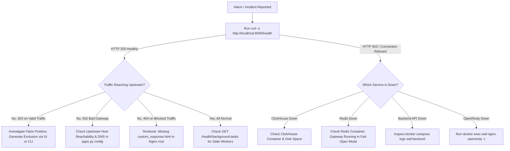

# CyberSentinel WAF — Operational Runbook & Troubleshooting Guide

**Version:** 3.0.0  
**Target Audience:** Site Reliability Engineers (SRE), System Administrators, and SOC Incident Responders  
**Security Classification:** Enterprise Operations Manual  
**Status:** Verified from Codebase (`backend/app/`, `openresty/`, `scripts/`, `configs/`)

---

## Table of Contents

1. [Emergency Triage Decision Matrix](#1-emergency-triage-decision-matrix)
2. [Diagnostic Tooling & Platform Health Checkers](#2-diagnostic-tooling--platform-health-checkers)
3. [Emergency Administrator Recovery Runbooks](#3-emergency-administrator-recovery-runbooks)
   - [Runbook A: Admin Password Reset](#runbook-a-admin-password-reset)
   - [Runbook B: Brute-Force Rate Limiting Lockout Removal](#runbook-b-brute-force-rate-limiting-lockout-removal)
   - [Runbook C: Admin IP Allowlist Lockout Bypass](#runbook-c-admin-ip-allowlist-lockout-bypass)
   - [Runbook D: TOTP MFA Loss Emergency Recovery](#runbook-d-totp-mfa-loss-emergency-recovery)
4. [Gateway & Ingress Failure Scenarios (`waf-nginx`)](#4-gateway--ingress-failure-scenarios-waf-nginx)
   - [Scenario 1: OpenResty Configuration Compilation Failure](#scenario-1-openresty-configuration-compilation-failure)
   - [Scenario 2: WAF Blocks Returning 404 Instead of 403](#scenario-2-waf-blocks-returning-404-instead-of-403)
   - [Scenario 3: Lua Shared Memory Dictionary Saturation](#scenario-3-lua-shared-memory-dictionary-saturation)
5. [ClickHouse Ingestion & Analytics Failures (`waf-clickhouse`)](#5-clickhouse-ingestion--analytics-failures-waf-clickhouse)
   - [Scenario 1: ClickHouse Connection Refused](#scenario-1-clickhouse-connection-refused)
   - [Scenario 2: Log Ingestion Watchdog Staleness Alert](#scenario-2-log-ingestion-watchdog-staleness-alert)
   - [Scenario 3: Database Verification & Schema Recovery](#scenario-3-database-verification--schema-recovery)
6. [Redis Degraded Mode & State Failure Recovery (`waf-redis`)](#6-redis-degraded-mode--state-failure-recovery-waf-redis)
7. [Machine Learning Engine Degradation (`waf-ml`)](#7-machine-learning-engine-degradation-waf-ml)
8. [ClamAV Antivirus Stream Timeouts (`waf-clamav`)](#8-clamav-antivirus-stream-timeouts-waf-clamav)
9. [High Availability & VRRP VIP Failover Issues](#9-high-availability--vrrp-vip-failover-issues)
10. [Disk Space Exhaustion & Emergency Pruning](#10-disk-space-exhaustion--emergency-pruning)

---

## 1. Emergency Triage Decision Matrix

Use the flowchart below to identify the root cause of service disruption:



---

## 2. Diagnostic Tooling & Platform Health Checkers

### Unified Platform Health Endpoint
Queries database connections, Redis socket, and OpenResty state:
```bash
curl -s http://localhost:8000/health | jq .
```
**Expected Output:**
```json
{
  "status": "healthy",
  "version": "3.0.0",
  "services": {
    "sqlite": "connected",
    "redis": "connected",
    "clickhouse": "connected",
    "openresty": "running"
  },
  "total_events_ingested": 142058
}
```

### Background Task Heartbeat Inspector
Validates that asynchronous background loops have not crashed or stalled:
```bash
curl -s "http://localhost:8000/health/background-tasks" \
  -H "X-API-Key: <admin_api_key>" | jq .
```
**Monitored Heartbeat Workers:**
- `audit_log_ingestor`: Tails `/var/log/modsec/modsec_audit.log` and flushes batches into ClickHouse.
- `log_retention_service`: Enforces retention windows (deletes partitions older than 90 days).
- `api_discovery_service`: Mines API request endpoints and updates parameter catalogs.
- `redis_degraded_monitor`: Surfaces when OpenResty Lua enters fail-open bypass.
- `threat_intel_service`: Syncs Spamhaus DROP lists into Redis.
- `good_bot_service`: Refreshes verified Googlebot/Bingbot IP allowlists.

---

## 3. Emergency Administrator Recovery Runbooks

### Runbook A: Admin Password Reset

When all administrator passwords are lost or expired, execute the out-of-band CLI utility [`scripts/reset-password.py`](file:///opt/ModSecurity/WAF_GUI/scripts/reset-password.py):

```bash
# Execute password reset script directly on host
cd /opt/ModSecurity/WAF_GUI
sudo python3 scripts/reset-password.py
```

**Interactive Prompts:**
1. Select target username (e.g. `admin`).
2. Input new password (minimum 12 characters, requiring uppercase, lowercase, digit, and special character).
3. The script executes the following atomic operations directly against `backend/app/data/users.db`:
   - Computes secure bcrypt salt and hash.
   - Sets `enabled = 1`.
   - Increments `session_version = session_version + 1` (immediately invalidating any compromised existing sessions).

---

### Runbook B: Brute-Force Rate Limiting Lockout Removal

If an administrator's IP or username has triggered the brute-force protection sliding window (HTTP 429 Too Many Requests):

#### Method 1: Flush Redis Rate Limit Keys (Instant Unban)
```bash
# Connect to Redis container CLI
docker exec -it waf-redis redis-cli -a "<REDIS_PASSWORD>"

# Search for the locked-out keys
KEYS "rate_limit:*"
KEYS "user:admin*"

# Remove the specific IP or account lockout key
DEL "rate_limit:192.168.1.50"
DEL "rate_limit:user:admin"
```

#### Method 2: Restart Redis Container
```bash
# Flushes in-memory rate-limiter counters immediately
docker compose restart waf-redis
```

---

### Runbook C: Admin IP Allowlist Lockout Bypass

If the Zero-Trust Admin Login Allowlist was enabled with an incorrect CIDR subnet, locking out all administrators:

1. Open the settings file directly on the host filesystem:
   ```bash
   sudo nano /opt/ModSecurity/WAF_GUI/backend/app/config/settings.json
   ```
2. Locate the `admin_login_allowlist` block:
   ```json
   "admin_login_allowlist": {
     "enabled": false,
     "allowed_networks": []
   }
   ```
3. Set `"enabled": false` and save the file (`Ctrl+O`, `Ctrl+X`).
4. Restart the backend API container to reload settings:
   ```bash
   docker compose restart waf-backend
   ```

---

### Runbook D: TOTP MFA Loss Emergency Recovery

If an administrator has lost their multi-factor authenticator device and cannot complete `/auth/login/mfa`:

#### Method 1: Via Another Admin Account (UI / API)
Another admin can execute:
```bash
curl -X POST "http://localhost:8000/users/<USER_ID>/mfa/disable" \
  -H "X-API-Key: <admin_api_key>"
```

#### Method 2: Direct SQLite Database Override
```bash
# Access the active users database
sqlite3 /opt/ModSecurity/WAF_GUI/backend/app/data/users.db

# Clear MFA secret and flag for user
sqlite> UPDATE users SET mfa_enabled = 0, mfa_secret = NULL WHERE username = 'admin';
sqlite> .quit
```
The user can now log in using standard username/password and re-enroll MFA under **Profile > Security**.

---

## 4. Gateway & Ingress Failure Scenarios (`waf-nginx`)

### Scenario 1: OpenResty Configuration Compilation Failure

**Symptoms:** Gateway refuses to start or `POST /system/nginx-reload` returns HTTP 502.

**Diagnostic Command:**
```bash
docker exec -it waf-nginx openresty -t
```

**Common Causes & Remediation:**
1. **Syntax error in custom rules:** Check `/etc/nginx/modsec/custom-rules.conf`. Revert by removing invalid lines or restoring `/etc/nginx/modsec/custom-rules.conf.bak`.
2. **Duplicate ModSecurity rule IDs:** If an exclusion or custom rule collides with an existing CRS rule ID (e.g. in range 900000–999999). Custom rule IDs must reside in range `10000000+`.
3. **Invalid SSL certificate path:** Verify that files referenced in `server {}` blocks exist inside the container under `/etc/nginx/ssl/`.

---

### Scenario 2: WAF Blocks Returning 404 Instead of 403

**Symptoms:** A blocked attack request receives an HTTP 404 Not Found from Nginx instead of the configured branded 403 Forbidden page.

**Root Cause:**
In `nginx_manager.py`, protected application server blocks configure:
```nginx
error_page 403 /custom_403.html;
location = /custom_403.html {
    alias /etc/nginx/html/custom_response.html;
    internal;
}
```
If `/etc/nginx/html/custom_response.html` is missing, Nginx throws a 404 while trying to serve the 403 block page.

**Remediation:**
1. Force backend to re-seed the default block page:
   ```bash
   docker compose restart waf-backend
   ```
2. Or manually populate the file:
   ```bash
   docker exec -it waf-nginx mkdir -p /etc/nginx/html
   docker cp configs/nginx/html/custom_response.html waf-nginx:/etc/nginx/html/custom_response.html
   docker exec -it waf-nginx openresty -s reload
   ```

---

### Scenario 3: Lua Shared Memory Dictionary Saturation

**Symptoms:** OpenResty error logs contain:
`[error] ... lua_shared_dict 'waf_ratelimit' is full`

**Remediation:**
Open `/opt/ModSecurity/WAF_GUI/configs/nginx/nginx.conf` and increase the shared memory dictionary allocations:
```nginx
# Increase from 20m to 50m
lua_shared_dict waf_ratelimit 50m;
lua_shared_dict waf_ip_rep 50m;
lua_shared_dict waf_threat_intel 50m;
```
Reload Nginx:
```bash
docker exec -it waf-nginx openresty -s reload
```

---

## 5. ClickHouse Ingestion & Analytics Failures (`waf-clickhouse`)

### Scenario 1: ClickHouse Connection Refused

**Symptoms:** Dashboard shows empty events; `/health` returns `"clickhouse": "disconnected"`.

**Troubleshooting Steps:**
1. Verify container runtime state:
   ```bash
   docker compose ps waf-clickhouse
   ```
2. Inspect ClickHouse server logs:
   ```bash
   docker compose logs --tail=100 waf-clickhouse
   ```
3. Test TCP connection from host:
   ```bash
   nc -zv 127.0.0.1 8123
   ```
4. Test native client query:
   ```bash
   docker exec -it waf-clickhouse clickhouse-client -q "SELECT 1"
   ```

---

### Scenario 2: Log Ingestion Watchdog Staleness Alert

**Symptoms:** Admin receives `stale_background_task` alert for `audit_log_ingestor`. Security events are occurring but not appearing in the Events table.

**Investigation:**
1. Verify ModSecurity audit log is being generated by OpenResty:
   ```bash
   ls -lh /opt/ModSecurity/WAF_GUI/logs/modsec/modsec_audit.log
   ```
2. Check backend log parser process:
   ```bash
   docker compose logs --tail=100 waf-backend | grep -i "ingest"
   ```
3. Check ClickHouse buffer table status:
   ```bash
   docker exec -it waf-clickhouse clickhouse-client -q \
     "SELECT count() FROM waf_logs.waf_events"
   ```
4. If stalled, restart backend ingestor tasks:
   ```bash
   docker compose restart waf-backend
   ```

---

### Scenario 3: Database Verification & Schema Recovery

Execute the bundled database verification utility [`scripts/verify_clickhouse_db.py`](file:///opt/ModSecurity/WAF_GUI/scripts/verify_clickhouse_db.py):

```bash
docker exec -it waf-backend python3 /app/scripts/verify_clickhouse_db.py
```
This script checks:
- Connection reachability.
- Row counts in tables `waf_events`, `ml_events`, `alert_history`, `analyst_feedback`.
- Structural integrity of columnar schemas.
- Performs an end-to-end write-then-read ingestion test.

---

## 6. Redis Degraded Mode & State Failure Recovery (`waf-redis`)

### OpenResty Silent Fail-Open Behavior
When Redis is down or unreachable:
1. `ml_check.lua` catches connection errors safely.
2. Ingress traffic is **NOT dropped**; instead, the gateway automatically falls back to native ModSecurity inspection (bypassing dynamic rate limits and IP reputation checks).
3. The backend `redis_degraded_monitor` task detects this condition and fires a high-priority SOC alert: `waf_redis_degraded`.

### Recovery Procedure
```bash
# 1. Check Redis container status
docker compose ps waf-redis

# 2. Inspect Redis logs
docker compose logs --tail=50 waf-redis

# 3. Test Redis ping
docker exec -it waf-redis redis-cli -a "<REDIS_PASSWORD>" ping

# 4. Restart Redis service
docker compose restart waf-redis
```

---

## 7. Machine Learning Engine Degradation (`waf-ml`)

### Passive Fail-Open (`crs_only_fallback`)
If `waf-ml` (port 9000) experiences high CPU load, inference timeout (>500ms), or container failure:
- OpenResty's `ml_decide.lua` logs a warning and falls back to native CRS anomaly scoring (`crs_only_fallback()`).
- Legitimate traffic is never blocked due to an ML container outage.

### Model Retraining Recovery & Rollback
If a newly retrained model exhibits high false-positive rates:
```bash
# Query available model checkpoints
curl -s "http://localhost:8000/ml/backups" \
  -H "X-API-Key: <admin_api_key>" | jq .

# Trigger immediate rollback to previous stable checkpoint
curl -X POST "http://localhost:8000/ml/rollback" \
  -H "X-API-Key: <admin_api_key>" \
  -H "Content-Type: application/json" \
  -d '{"timestamp": "2026-09-20T12:00:00"}'
```

---

## 8. ClamAV Antivirus Stream Timeouts (`waf-clamav`)

**Symptoms:** File uploads to protected applications hang or trigger HTTP 500 errors.

**Troubleshooting Steps:**
1. Check ClamAV container memory usage:
   ```bash
   docker stats waf-clamav
   ```
   *Note: ClamAV requires ~1.5 GB RAM to hold current virus signature definitions.*
2. Check ClamAV daemon connectivity from backend:
   ```bash
   curl -X POST "http://localhost:8000/settings/malware-scanning/check-now" \
     -H "X-API-Key: <admin_api_key>"
   ```
3. If ClamAV runs out of memory (OOMKilled), increase the container memory limit in `docker-compose.yml` to `2560M` and restart:
   ```bash
   docker compose up -d waf-clamav
   ```

---

## 9. High Availability & VRRP VIP Failover Issues

### Split-Brain Symptoms
Both Node 1 and Node 2 report state `MASTER` in `/var/log/syslog`, causing ARP flapping and dropped TCP sessions.

**Diagnostic Check:**
```bash
# Check VRRP advertisements on host network interface
sudo tcpdump -i eth0 vrrp -n
```

**Remediation:**
1. Verify firewall rules allow VRRP multicast:
   ```bash
   sudo ufw allow in on eth0 proto vrrp
   sudo iptables -A INPUT -p vrrp -j ACCEPT
   ```
2. Verify VRRP authentication password matches identically on both nodes in `/etc/keepalived/keepalived.conf`.
3. Manually demote Node 2:
   ```bash
   sudo systemctl stop keepalived # On Node 2
   ```

---

## 10. Disk Space Exhaustion & Emergency Pruning

If host disk usage reaches 100%:

### 1. Prune ModSecurity Audit Logs
```bash
# Remove raw audit logs older than 7 days
sudo find /opt/ModSecurity/WAF_GUI/logs/modsec/ -name "*.json" -mtime +7 -delete
```

### 2. Force ClickHouse Partition Dropping
Trigger manual log retention run:
```bash
curl -X POST "http://localhost:8000/health/log-retention/run" \
  -H "X-API-Key: <admin_api_key>"
```

### 3. Clear Docker Build Cache & Dangling Images
```bash
docker system prune -f
```
